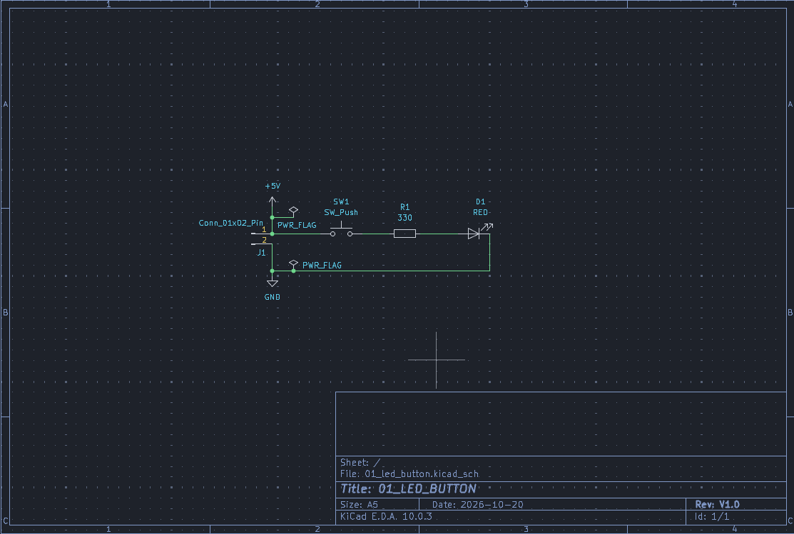
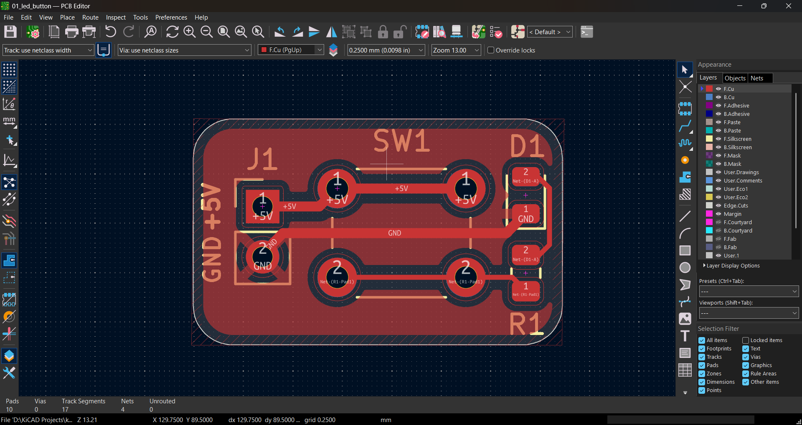
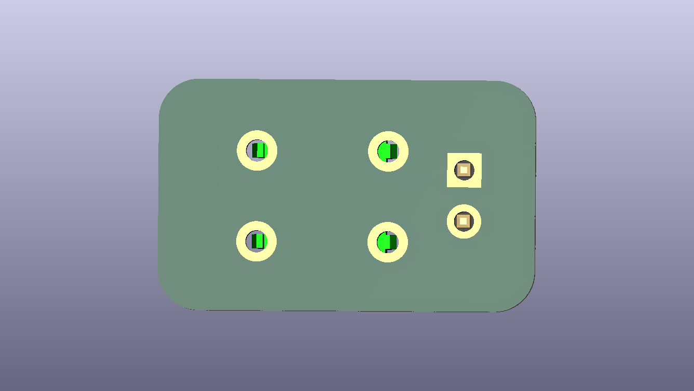

# LED + Push-Button PCB


> A fully documented KiCad 10 project: a 5 V push-button that lights a red LED through a current-limiting resistor.
> **Project 1** of my KiCad learning path, from basic electronics to advanced PCB design.

[← Back to all projects](../README.md)


## Table of contents

- [Overview](#overview)
- [Key specifications](#key-specifications)
- [Gallery](#gallery)
- [How the circuit works](#how-the-circuit-works)
- [Design calculations (summary)](#design-calculations-summary)
- [Bill of materials](#bill-of-materials)
- [Netlist](#netlist)
- [Repository structure](#repository-structure)
- [Getting started](#getting-started)
- [Testing](#testing)
- [Verification status](#verification-status)
- [Future improvements](#future-improvements)
- [Learning-path roadmap](#learning-path-roadmap)
- [License](#license)

## Overview

This board is deliberately simple so that the **complete professional PCB workflow** is covered end to end:

1. Electronics fundamentals and component calculation
2. Schematic capture with power flags and a clean ERC
3. Footprint assignment
4. Board setup: stackup, design constraints, net classes
5. Placement, routing and copper pour
6. DRC, 3D check and Gerber verification
7. Manufacturing file export for a low-cost 2-layer fab

**What it does:** a 5 V supply is connected to header `J1`. While push-button `SW1` is held down, current flows through resistor `R1` and LED `D1`, and the LED lights. `R1` limits the current to about 9 mA.

The full engineering write-up (theory, derivations, KiCad configuration, layout rules, manufacturing settings) is in [`docs/DESIGN_NOTES.md`](docs/DESIGN_NOTES.md).

## Key specifications

| Parameter                 | Value                              |
| ------------------------- | ---------------------------------- |
| Supply voltage            | 5 V DC (via `J1`)                  |
| LED current (nominal)     | ≈ 9.1 mA                           |
| Current-limit resistor    | 330 Ω, 0805, 1 %                   |
| LED                       | Red, 0805, forward voltage ≈ 2.0 V |
| Board layers              | 2                                  |
| Board thickness           | 1.6 mm                             |
| Copper weight             | 1 oz (35 µm)                       |
| Board size                | 18.750 × 11.480 mm                 |
| Components                | 4 (`J1`, `SW1`, `R1`, `D1`)        |
| Pads / nets / vias        | 10 / 4 / 0                         |
| Minimum track / clearance | 0.2 mm / 0.2 mm                    |
| Design tool               | KiCad 10.0.x                       |
| ERC / DRC                 | 0 errors / 0 errors                |

## Gallery

### Schematic



Full-size PDF: [`docs/schematic.pdf`](docs/schematic.pdf)

### PCB layout



### 3D views

| Top                                   | Bottom                                      |
| ------------------------------------- | ------------------------------------------- |
|  |  |

## How the circuit works

```
+5V ──► SW1 (push button) ──► R1 (330 Ω) ──► D1 (red LED) ──► GND
```

- `J1` brings in 5 V on pin 1 and ground on pin 2.
- `SW1` is normally open. Pressing it completes the loop.
- `R1` drops the surplus voltage so the LED current is safe.
- `D1` conducts only in the direction of the triangle (anode to cathode) and lights up.
- The same current flows through every part, because they are in series.

## Design calculations (summary)

**Ohm's law:**

$$V = I \times R$$

**Resistor value for a target LED current:**

$$R = \frac{V_S - V_F}{I_F} = \frac{5.0\ \text{V} - 2.0\ \text{V}}{10\ \text{mA}} = 300\ \Omega \;\rightarrow\; \text{330}\ \Omega\ \text{(standard E12 value)}$$

**Actual current with the standard value:**

$$I = \frac{V_S - V_F}{R} = \frac{3.0\ \text{V}}{330\ \Omega} \approx 9.09\ \text{mA}$$

**Power:**

$$P = V \times I = I^2 R$$

| Element           | Voltage drop | Current | Power                                  |
| ----------------- | ------------ | ------- | -------------------------------------- |
| `R1` (330 Ω)      | 3.0 V        | 9.09 mA | 27.3 mW (rating of 0805: about 125 mW) |
| `D1` (red LED)    | ≈ 2.0 V      | 9.09 mA | 18.2 mW                                |
| `SW1` (closed)    | ≈ 0 V        | 9.09 mA | ≈ 0 mW                                 |
| Total from supply | 5.0 V        | 9.09 mA | 45.5 mW                                |

Worst-case analysis (supply ±5 %, resistor ±1 %, LED forward voltage 1.8 V to 2.2 V) gives a current between **7.65 mA and 10.56 mA**, which is safe for the LED and the resistor. The full derivation is in [`docs/DESIGN_NOTES.md`](docs/DESIGN_NOTES.md#3-calculations).

## Bill of materials

| Ref   | Qty | Value          | Footprint                         | Description                   |
| ----- | --- | -------------- | --------------------------------- | ----------------------------- |
| `J1`  | 1   | Conn_01x02_Pin | `PinHeader_1x02_P2.54mm_Vertical` | 2-pin 2.54 mm header (5 V in) |
| `SW1` | 1   | SW_Push        | `SW_PUSH_6mm`                     | 6 mm tactile push-button      |
| `R1`  | 1   | 330 Ω          | `R_0805_2012Metric`               | Resistor, 1 %, 1/8 W          |
| `D1`  | 1   | RED            | `LED_0805_2012Metric`             | Red LED, 0805                 |

The same list is available as CSV in [`fabrication/bom.csv`](fabrication/bom.csv).

## Netlist

| Net             | Connections              |
| --------------- | ------------------------ |
| `+5V`           | `J1` pin 1, `SW1` pin 1  |
| `Net-(R1-Pad1)` | `SW1` pin 2, `R1` pin 1  |
| `Net-(D1-A)`    | `R1` pin 2, `D1` anode   |
| `GND`           | `D1` cathode, `J1` pin 2 |

## Repository structure

```
kicad-learning-path/
├── README.md                    Index of all projects
├── LICENSE
├── .gitignore
└── 01-led-button/               This project
    ├── README.md                You are here
    ├── 01_led_button.kicad_pro  KiCad project file
    ├── 01_led_button.kicad_sch  Schematic
    ├── 01_led_button.kicad_pcb  PCB layout
    ├── fabrication/
    │   ├── gerbers/             Gerber and drill files
    │   ├── 01_led_button_gerbers.zip
    │   └── bom.csv
    └── docs/
        ├── DESIGN_NOTES.md      Full engineering documentation
        ├── schematic.pdf
        ├── images/              Screenshots and 3D renders
        └── reports/             ERC and DRC reports
```

## Getting started

### Open the project

1. Install [KiCad 10](https://www.kicad.org/download/).
2. Clone or download the `kicad-learning-path` repository.
3. Open `01-led-button/01_led_button.kicad_pro` in KiCad. The project uses only the standard KiCad libraries.

### Rebuild the manufacturing files

1. Open the PCB editor and run **Inspect → Design Rules Checker**. It should report 0 errors.
2. Open **File → Fabrication Outputs → Gerbers** and **Generate Drill Files**. The exact settings are listed in [`docs/DESIGN_NOTES.md`](docs/DESIGN_NOTES.md#8-manufacturing-outputs).
3. Zip the output folder.

### Order the PCB

Upload `fabrication/01_led_button_gerbers.zip` to a PCB fabricator. Suggested options for a low-cost fab: 2 layers, 1.6 mm, 1 oz copper, HASL finish.

## Testing

Bring-up procedure and expected measurements are in [`docs/DESIGN_NOTES.md`](docs/DESIGN_NOTES.md#9-bring-up-and-testing). In short: apply 5 V, press `SW1`, and the LED lights; the voltage across `R1` should read about 3.0 V.

## Verification status

| Check                           | Result                    |
| ------------------------------- | ------------------------- |
| Electrical Rules Check (ERC)    | 0 errors                  |
| Design Rules Check (DRC)        | 0 errors, 0 unrouted nets |
| Gerber viewer check             | Passed                    |
| Physical board built and tested | Not yet                   |

Reports: [`docs/reports/`](docs/reports/)

## Future improvements

- Add reverse-polarity protection on `J1`
- Add mounting holes
- Reduce silkscreen text size and keep it clear of the board edge
- Add a second LED as a power indicator
- Replace the header with a USB-C connector (see Project 4)

## Learning-path roadmap

| #   | Project                    | Status  |
| --- | -------------------------- | ------- |
| 1   | Push-button LED board      | Done    |
| 2   | 555 timer LED blinker      | Planned |
| 3   | Transistor/MOSFET driver   | Planned |
| 4   | USB-C to 3.3 V power board | Planned |
| 5   | Microcontroller board      | Planned |
| 6   | Advanced capstone          | Planned |

## License

Released under the [MIT License](../LICENSE). Replace with a hardware license such as CERN-OHL-P-2.0 if you prefer.

Author: **Nitish Ghadage** · [GitHub](https://github.com/nitu2126)
