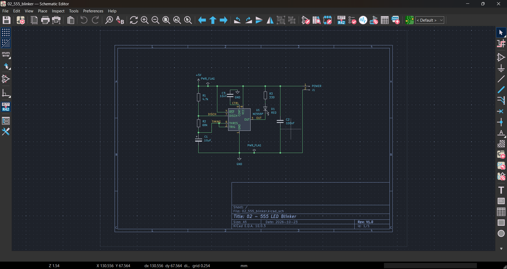
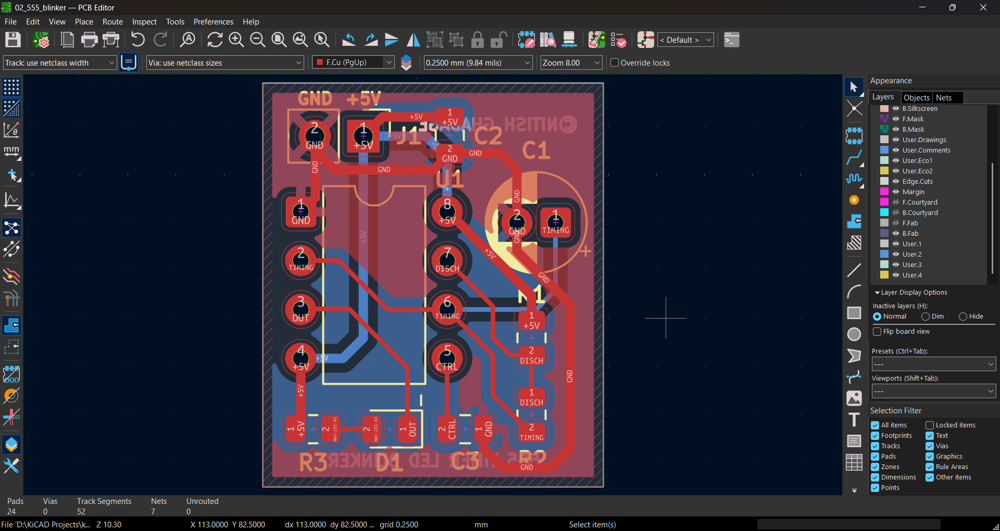
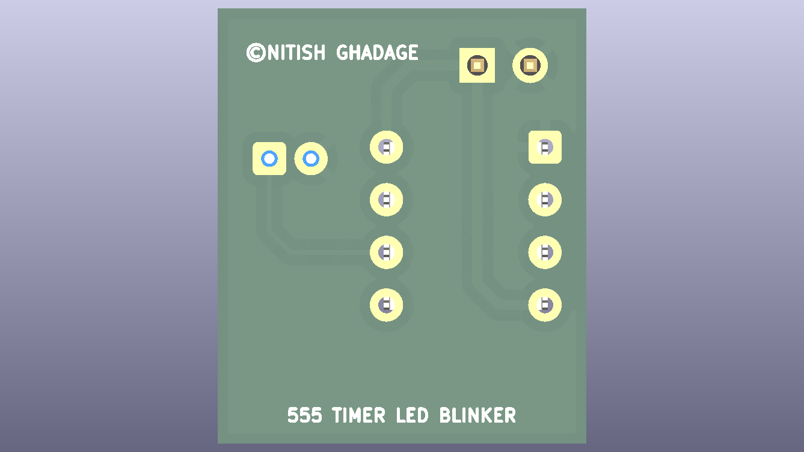

# 555 Timer LED Blinker


> A 5 V NE555 astable oscillator that flashes a red LED about once per second.
> **Project 2** of my [KiCad learning path](../README.md): capacitors, RC timing and the 555 timer.


## Table of contents

- [Overview](#overview)
- [Key specifications](#key-specifications)
- [Gallery](#gallery)
- [Timing diagram](#timing-diagram)
- [How the circuit works](#how-the-circuit-works)
- [Design calculations (summary)](#design-calculations-summary)
- [Bill of materials](#bill-of-materials)
- [Netlist](#netlist)
- [Repository structure](#repository-structure)
- [Getting started](#getting-started)
- [Testing](#testing)
- [Verification status](#verification-status)
- [Future improvements](#future-improvements)
- [License](#license)

## Overview

Project 1 used only a resistor, a switch and an LED. This board adds **time**: a capacitor charges and discharges through resistors, and a 555 timer IC turns that slow voltage ramp into a clean on/off signal.

New ideas compared with Project 1:

1. Capacitors: charge, discharge and the RC time constant
2. An integrated circuit with eight pins, and how to power it correctly
3. Polarised parts (electrolytic capacitor, IC pin 1, LED)
4. Decoupling (bypass) capacitors and where to place them
5. Net labels in the schematic
6. A through-hole DIP footprint, ground pours on both layers and stitching vias
7. A timing diagram in the documentation

**What it does:** with 5 V on header `J1`, the capacitor `C1` repeatedly charges and discharges between one third and two thirds of the supply voltage. The 555 flips its output each time a threshold is crossed. The LED is wired to light while the output is low, which gives about 0.47 s on and 0.50 s off.

The full engineering write-up (theory, derivations, KiCad configuration, layout rules, test procedure) is in [`docs/DESIGN_NOTES.md`](docs/DESIGN_NOTES.md).

## Key specifications

| Parameter                  | Value                                                                |
| -------------------------- | -------------------------------------------------------------------- |
| Supply voltage             | 5 V DC via `J1` (NE555 operating range 4.5 V to 16 V)                |
| Mode                       | Astable (free-running) oscillator                                    |
| Frequency                  | ≈ 1.02 Hz (period ≈ 0.975 s)                                         |
| LED on / off time          | 0.471 s / 0.504 s                                                    |
| Timing parts               | `R1` 4.7 kΩ, `R2` 68 kΩ, `C1` 10 µF                                  |
| Worst-case frequency range | ≈ 0.84 Hz to 1.29 Hz (dominated by the ±20 % electrolytic capacitor) |
| LED current                | ≈ 8.6 mA (`R3` 330 Ω)                                                |
| Supply current             | ≈ 2 mA (LED off), ≈ 12.7 mA (LED on), ≈ 7.2 mA average               |
| Board layers               | 2                                                                    |
| Board thickness            | 1.6 mm                                                               |
| Copper weight              | 1 oz (35 µm)                                                         |
| Board size                 | 17.750 × 21.004 mm                                                   |
| Components                 | 9 (`J1`, `U1`, `R1` to `R3`, `C1` to `C3`, `D1`)                     |
| Pads / nets                | 24 / 7                                                               |
| Design tool                | KiCad 10.0.x                                                         |
| ERC / DRC                  | 0 errors / 0 errors                                                  |

## Gallery

### Schematic



Full-size PDF: [`docs/schematic.pdf`](docs/schematic.pdf)

### PCB layout



### 3D views

| Top                                   | Bottom                                      |
| ------------------------------------- | ------------------------------------------- |
|  |  |

## Timing diagram


| Phase       | Capacitor voltage                               | Output (pin 3) | Discharge (pin 7)   | LED | Duration       |
| ----------- | ----------------------------------------------- | -------------- | ------------------- | --- | -------------- |
| Charging    | Rises from 1.67 V to 3.33 V through `R1` + `R2` | High           | Off (open)          | Off | `tH` = 0.504 s |
| Discharging | Falls from 3.33 V to 1.67 V through `R2`        | Low            | On (shorted to GND) | On  | `tL` = 0.471 s |

After power-up the capacitor starts at 0 V, so the first charging phase is longer (about 0.80 s) before the steady pattern begins.

## How the circuit works

```
                +5V
                 │
      ┌──────────┼───────────────┐
      │          R1 4.7k         R3 330
      │          │               │
      │ pin 8/4  ├── pin 7       D1 LED
      │          R2 68k          │
   NE555         │               │
      │ pin 6/2 ─┴── C1 10µF ─ GND
      │ pin 3 (OUT) ─────────────┘   (LED sinks current into the output)
      │ pin 1 ── GND
```

1. The capacitor charges through `R1` and `R2` while the output is high.
2. When its voltage reaches two thirds of the supply, the threshold comparator trips. The output goes low and the discharge transistor (pin 7) switches on.
3. The capacitor now discharges through `R2` only.
4. When its voltage falls to one third of the supply, the trigger comparator trips. The output goes high and the discharge transistor switches off.
5. The cycle repeats forever.

The LED is connected between `+5V` (through `R3`) and the output, so it lights while the output is low. At a 5 V supply the 555's low output level is much closer to the rail than its high level is, which makes the LED current predictable.

## Design calculations (summary)

**Timing** (from the NE555 datasheet, astable mode):

$$t_H = 0.693\,(R_1 + R_2)\,C_1 = 0.693 \times 72.7\ \text{k}\Omega \times 10\ \mu\text{F} = 0.504\ \text{s}$$

$$t_L = 0.693\,R_2\,C_1 = 0.693 \times 68\ \text{k}\Omega \times 10\ \mu\text{F} = 0.471\ \text{s}$$

$$T = t_H + t_L = 0.693\,(R_1 + 2R_2)\,C_1 = 0.975\ \text{s} \qquad f = \frac{1.44}{(R_1 + 2R_2)\,C_1} \approx 1.02\ \text{Hz}$$

**LED current** (output low level of about 0.15 V at 8 mA, from the datasheet):

$$I_{LED} = \frac{V_{CC} - V_F - V_{OL}}{R_3} = \frac{5.0 - 2.0 - 0.15}{330\ \Omega} \approx 8.6\ \text{mA}$$

| Quantity                             | Value                         |
| ------------------------------------ | ----------------------------- |
| Period / frequency                   | 0.975 s / 1.02 Hz             |
| LED on-time share                    | 48.3 %                        |
| LED current (nominal / worst case)   | 8.64 mA / 6.45 mA to 10.25 mA |
| `R3` power                           | 24.6 mW (maximum 34.4 mW)     |
| `R1` current while the output is low | 1.06 mA                       |

The full derivation, worst-case analysis and component ratings are in [`docs/DESIGN_NOTES.md`](docs/DESIGN_NOTES.md#3-calculations).

## Bill of materials

| Ref  | Qty | Value          | Footprint                         | Description                               |
| ---- | --- | -------------- | --------------------------------- | ----------------------------------------- |
| `J1` | 1   | Conn_01x02_Pin | `PinHeader_1x02_P2.54mm_Vertical` | 2-pin header, 5 V in                      |
| `U1` | 1   | NE555P         | `DIP-8_W7.62mm`                   | 555 timer, DIP-8 (use an 8-pin socket)    |
| `R1` | 1   | 4.7 kΩ         | `R_0805_2012Metric`               | Resistor, 1 %                             |
| `R2` | 1   | 68 kΩ          | `R_0805_2012Metric`               | Resistor, 1 %                             |
| `R3` | 1   | 330 Ω          | `R_0805_2012Metric`               | LED current-limit resistor, 1 %           |
| `C1` | 1   | 10 µF, 16 V    | `CP_Radial_D5.0mm_P2.00mm`        | Electrolytic timing capacitor (polarised) |
| `C2` | 1   | 100 nF         | `C_0805_2012Metric`               | Ceramic decoupling capacitor, X7R, 50 V   |
| `C3` | 1   | 10 nF          | `C_0805_2012Metric`               | Ceramic control-pin capacitor, X7R, 50 V  |
| `D1` | 1   | RED            | `LED_0805_2012Metric`             | Red LED, 0805                             |

The same list is available as CSV in [`fabrication/bom.csv`](fabrication/bom.csv).

## Netlist

| Net          | Connections                                                  |
| ------------ | ------------------------------------------------------------ |
| `+5V`        | `J1`-1, `U1`-8 (VCC), `U1`-4 (RESET), `R1`-1, `R3`-1, `C2`-1 |
| `GND`        | `J1`-2, `U1`-1 (GND), `C1`-2 (−), `C2`-2, `C3`-2             |
| `DISCH`      | `U1`-7, `R1`-2, `R2`-1                                       |
| `TIMING`     | `U1`-6 (THRES), `U1`-2 (TRIG), `R2`-2, `C1`-1 (+)            |
| `CTRL`       | `U1`-5, `C3`-1                                               |
| `Net-(D1-A)` | `R3`-2, `D1` anode                                           |
| `OUT`        | `U1`-3, `D1` cathode                                         |

## Repository structure

This project lives in the `02-555-blinker/` folder of the [kicad-learning-path](../README.md) repository.

```
02-555-blinker/
├── README.md
├── 02_555_blinker.kicad_pro     KiCad project file
├── 02_555_blinker.kicad_sch     Schematic
├── 02_555_blinker.kicad_pcb     PCB layout
├── fabrication/
│   ├── gerbers/                 Gerber and drill files
│   ├── 02_555_blinker_gerbers.zip
│   └── bom.csv
└── docs/
    ├── DESIGN_NOTES.md          Full engineering documentation
    ├── schematic.pdf
    ├── images/                  Timing diagram, screenshots and 3D renders
    └── reports/                 ERC and DRC reports
```

## Getting started

### Open the project

1. Install [KiCad 10](https://www.kicad.org/download/).
2. Clone or download this repository.
3. Open `02-555-blinker/02_555_blinker.kicad_pro` in KiCad. The project uses only the standard KiCad libraries.

### Rebuild the manufacturing files

1. Open the PCB editor and run **Inspect → Design Rules Checker**. It should report 0 errors.
2. Open **File → Fabrication Outputs → Gerbers** and **Generate Drill Files**. The exact settings are listed in [`docs/DESIGN_NOTES.md`](docs/DESIGN_NOTES.md#9-manufacturing-outputs).
3. Zip the output folder.

### Order the PCB

Upload `fabrication/02_555_blinker_gerbers.zip` to a PCB fabricator. Suggested options for a low-cost fab: 2 layers, 1.6 mm, 1 oz copper, HASL finish.

## Testing

Bring-up steps, expected measurements and a troubleshooting table are in [`docs/DESIGN_NOTES.md`](docs/DESIGN_NOTES.md#10-bring-up-and-testing). In short: apply 5 V and the LED should flash about 31 times in 30 seconds (anything from 25 to 39 is within tolerance).

## Verification status

| Check                           | Result                    |
| ------------------------------- | ------------------------- |
| Electrical Rules Check (ERC)    | 0 errors                  |
| Design Rules Check (DRC)        | 0 errors, 0 unrouted nets |
| Gerber viewer check             | Passed                    |
| Physical board built and tested | Not yet                   |

Reports: [`docs/reports/`](docs/reports/)

## Future improvements

- Add a potentiometer in place of `R2` to make the blink rate adjustable
- Add reverse-polarity protection on `J1` (see Project 5 in the [roadmap](../ROADMAP.md))
- Try a CMOS 555 (for example TLC555) for lower supply current
- Add a second LED that flashes in the opposite phase
- Add mounting holes

## License

Released under the [MIT License](../LICENSE).

Author: **Nitish Ghadage** · [GitHub](https://github.com/nitu2126)
