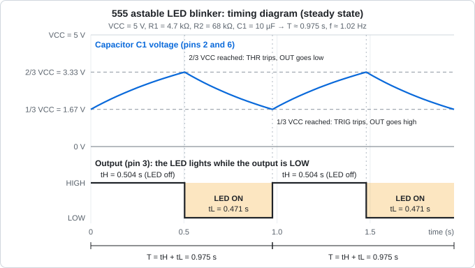

# Design Notes: 555 Timer LED Blinker

Revision 1.0 · KiCad 10.0.x · Last updated: 2026-10-21

This document records every engineering decision behind the board: the electronics theory, the derivation of the timing equations, the calculations, the timing diagram, the KiCad configuration, the layout rules, the verification results and the manufacturing settings.

## Contents

1. [Requirements](#1-requirements)
2. [Electronics background](#2-electronics-background)
3. [Calculations](#3-calculations)
4. [Timing diagram](#4-timing-diagram)
5. [Schematic](#5-schematic)
6. [KiCad configuration](#6-kicad-configuration)
7. [Layout](#7-layout)
8. [Verification](#8-verification)
9. [Manufacturing outputs](#9-manufacturing-outputs)
10. [Bring-up and testing](#10-bring-up-and-testing)
11. [Lessons learned](#11-lessons-learned)
12. [References](#12-references)

---

## 1. Requirements

| # | Requirement |
|---|---|
| R1 | Powered from a 5 V DC source through a 2-pin header |
| R2 | The LED flashes automatically, with no button or microcontroller |
| R3 | Blink rate of about 1 Hz, with the LED on for roughly half of each cycle |
| R4 | LED current between 5 mA and 10 mA in every tolerance case |
| R5 | Stable operation: the timer must be decoupled and its control pin bypassed |
| R6 | Hand-solderable parts (DIP socket, 0805 SMD, one radial capacitor) |
| R7 | 2-layer board that a low-cost fab can build without special options |
| R8 | Zero ERC errors and zero DRC errors |

---

## 2. Electronics background

### 2.1 The capacitor

A capacitor stores energy in an electric field between two plates. Three relationships describe it:

$$Q = C \times V \qquad I = C\,\frac{dV}{dt} \qquad E = \tfrac{1}{2}\,C\,V^2$$

| Symbol | Meaning | Unit |
|---|---|---|
| $Q$ | Stored charge | coulomb (C) |
| $C$ | Capacitance | farad (F) |
| $V$ | Voltage across the capacitor | volt (V) |
| $I$ | Current into the capacitor | ampere (A) |
| $E$ | Stored energy | joule (J) |

The middle equation is the important one: **current only flows while the voltage is changing**. A capacitor blocks steady DC and passes changes. A larger capacitor needs more charge to change its voltage by the same amount, so it changes more slowly for the same current.

| Type | Used here for | Notes |
|---|---|---|
| Aluminium electrolytic (`C1`) | Timing capacitor, 10 µF | Large value, **polarised** (reverse voltage damages it), tolerance typically ±20 % |
| Ceramic X7R (`C2`, `C3`) | Decoupling and control-pin bypass | Small value, not polarised, low series inductance |

### 2.2 Charging and discharging through a resistor

When a capacitor is charged through a resistor $R$ from a source $V_S$, starting at voltage $V_0$:

$$v_C(t) = V_S - (V_S - V_0)\,e^{-t/\tau} \qquad \tau = R \times C$$

When it discharges through a resistor to 0 V:

$$v_C(t) = V_0\,e^{-t/\tau}$$

$\tau$ is the **time constant**. After a given number of time constants the capacitor has covered this fraction of the distance to its final value:

| Elapsed time | Fraction of the way |
|---|---|
| 1 τ | 63.2 % |
| 2 τ | 86.5 % |
| 3 τ | 95.0 % |
| 5 τ | 99.3 % |

### 2.3 Inside the 555 timer

The NE555 contains five blocks:

| Block | Function |
|---|---|
| Resistor divider (three equal resistors) | Creates two reference voltages: two thirds and one third of VCC |
| Threshold comparator (pin 6, THRES) | Trips when the input rises above two thirds of VCC |
| Trigger comparator (pin 2, TRIG) | Trips when the input falls below one third of VCC |
| SR flip-flop | Remembers which comparator tripped last |
| Output stage (pin 3) and discharge transistor (pin 7) | Drives the output, and shorts pin 7 to ground while the output is low |

Function table (paraphrased from the datasheet, voltages are nominal):

| RESET | TRIG voltage | THRES voltage | Output | Discharge switch |
|---|---|---|---|---|
| Low | any | any | Low | On |
| High | below 1/3 VCC | any | High | Off |
| High | above 1/3 VCC | above 2/3 VCC | Low | On |
| High | above 1/3 VCC | below 2/3 VCC | Unchanged (holds its previous state) | Unchanged |

Because both reference levels are fixed fractions of VCC, the timing is almost independent of the supply voltage (the datasheet gives about 0.3 % per volt for the NE555 in astable mode).

Pin functions (DIP-8):

| Pin | Name | Function in this circuit |
|---|---|---|
| 1 | GND | Ground |
| 2 | TRIG | Tied to pin 6 and to the timing capacitor |
| 3 | OUT | Sinks the LED current |
| 4 | RESET | Tied to VCC so the timer is never held in reset |
| 5 | CONT | Bypassed to ground with `C3` |
| 6 | THRES | Tied to pin 2 and to the timing capacitor |
| 7 | DISCH | Discharges the capacitor through `R2` |
| 8 | VCC | +5 V |

### 2.4 How the astable oscillator works

1. At power-up the capacitor is empty (0 V). The trigger comparator sees a voltage below one third of VCC, so the output goes high and the discharge transistor is off.
2. The capacitor charges through `R1` and `R2` toward VCC.
3. When its voltage rises above one third of VCC, nothing changes: the flip-flop holds its state.
4. When its voltage reaches two thirds of VCC, the threshold comparator trips. The output goes low and the discharge transistor switches on.
5. The capacitor now discharges through `R2` into pin 7. `R1` only feeds current into pin 7 during this phase.
6. When its voltage falls to one third of VCC, the trigger comparator trips. The output goes high, the discharge transistor switches off, and the cycle repeats from step 2.

From then on the capacitor voltage swings between one third and two thirds of VCC.

### 2.5 Derivation of the timing equations

**High time.** The capacitor charges from $V_{CC}/3$ toward $V_{CC}$ through $R_1 + R_2$ and stops at $2V_{CC}/3$:

$$\tfrac{2}{3}V_{CC} = V_{CC} - \left(V_{CC} - \tfrac{1}{3}V_{CC}\right)e^{-t_H/\tau_c} \;\Rightarrow\; e^{-t_H/\tau_c} = \tfrac{1}{2} \;\Rightarrow\; t_H = \ln 2 \times (R_1 + R_2)\,C \approx 0.693\,(R_1 + R_2)\,C$$

**Low time.** The capacitor discharges from $2V_{CC}/3$ to $V_{CC}/3$ through $R_2$ only:

$$\tfrac{1}{3}V_{CC} = \tfrac{2}{3}V_{CC}\,e^{-t_L/\tau_d} \;\Rightarrow\; e^{-t_L/\tau_d} = \tfrac{1}{2} \;\Rightarrow\; t_L = \ln 2 \times R_2\,C \approx 0.693\,R_2\,C$$

**Period, frequency and duty cycle:**

$$T = t_H + t_L = 0.693\,(R_1 + 2R_2)\,C \qquad f = \frac{1}{T} \approx \frac{1.44}{(R_1 + 2R_2)\,C} \qquad \frac{t_H}{T} = \frac{R_1 + R_2}{R_1 + 2R_2}$$

$V_{CC}$ cancels out of every step, which is why the frequency does not depend on the supply voltage.

**Power-up.** The first charge starts from 0 V instead of $V_{CC}/3$, so it takes longer:

$$t_{first} = \ln 3 \times (R_1 + R_2)\,C = 1.099 \times 0.727\ \text{s} \approx 0.80\ \text{s}$$

---

## 3. Calculations

### 3.1 Targets and constraints

| Item | Value | Source |
|---|---|---|
| Supply voltage $V_{CC}$ | 5.0 V | Requirement R1 |
| Target frequency | about 1 Hz | Requirement R3 |
| Target duty cycle | close to 50 % | Requirement R3 |
| $R_1$ lower limit | 1 kΩ or more | Keeps the discharge current and the wasted current small |
| $R_1 + R_2$ upper limit | far below 3.4 MΩ at 5 V | Datasheet limit set by the threshold input current |

### 3.2 Choosing the timing components

1. **Choose $C_1$ first.** 10 µF is a common electrolytic value that gives convenient resistor values at 1 Hz.
2. **Total resistance needed** for $f = 1$ Hz:

$$R_1 + 2R_2 = \frac{1.44}{f\,C_1} = \frac{1.44}{1 \times 10\ \mu\text{F}} = 144\ \text{k}\Omega$$

3. **Make $R_2$ much larger than $R_1$** so the duty cycle approaches 50 %. With $R_1$ = 4.7 kΩ:

$$R_2 = \frac{144\ \text{k}\Omega - 4.7\ \text{k}\Omega}{2} = 69.7\ \text{k}\Omega \;\rightarrow\; \text{68 k}\Omega\ \text{(standard E12 value)}$$

### 3.3 Timing results

| Quantity | Formula | Result |
|---|---|---|
| $\tau_c = (R_1 + R_2)\,C_1$ | 72.7 kΩ × 10 µF | 0.727 s |
| $\tau_d = R_2\,C_1$ | 68 kΩ × 10 µF | 0.680 s |
| $t_H$ | 0.693 × 0.727 s | 0.504 s |
| $t_L$ | 0.693 × 0.680 s | 0.471 s |
| $T$ | $t_H + t_L$ | 0.975 s |
| $f$ | 1.44 / (140.7 kΩ × 10 µF) | 1.02 Hz (the exact form with ln 2 gives 1.025 Hz) |
| Output high share | $t_H / T$ | 51.7 % |
| LED on share (output low) | $t_L / T$ | 48.3 % |

### 3.4 LED current

The LED sits between `+5V` (through `R3`) and the output pin, so the output pin **sinks** the LED current while it is low.

Why sink instead of source? At a 5 V supply the datasheet gives a low-level output voltage of typically 0.15 V (maximum 0.4 V) at 8 mA. The high-level output, in contrast, drops well below the supply: the datasheet lists only 3.3 V typical at 100 mA. A sinking LED therefore sees a predictable voltage across its resistor.

$$I_{LED} = \frac{V_{CC} - V_F - V_{OL}}{R_3} = \frac{5.0\ \text{V} - 2.0\ \text{V} - 0.15\ \text{V}}{330\ \Omega} = 8.64\ \text{mA}$$

| Element | Voltage | Current | Power |
|---|---|---|---|
| `R3` | 2.85 V | 8.64 mA | 24.6 mW (0805 rating about 125 mW) |
| `D1` | 2.0 V | 8.64 mA | 17.3 mW |
| Output pin (low) | 0.15 V | 8.64 mA | 1.3 mW |

### 3.5 Worst-case analysis

**LED current.** Assumptions: supply 5 V ± 5 %, `R3` ± 1 %, LED forward voltage 1.8 V to 2.2 V, output low voltage 0.10 V to 0.40 V.

| Case | $V_{CC}$ | $V_F$ | $V_{OL}$ | $R_3$ | Current | `R3` power |
|---|---|---|---|---|---|---|
| Nominal | 5.00 V | 2.0 V | 0.15 V | 330.0 Ω | 8.64 mA | 24.6 mW |
| Maximum | 5.25 V | 1.8 V | 0.10 V | 326.7 Ω | 10.25 mA | 34.4 mW |
| Minimum | 4.75 V | 2.2 V | 0.40 V | 333.3 Ω | 6.45 mA | 13.9 mW |

The current stays between 6.45 mA and 10.25 mA, inside requirement R4.

**Frequency.** Assumptions: `R1` and `R2` ± 1 %, `C1` ± 20 %. The datasheet adds a typical initial timing error of 2.25 % for the NE555 in astable mode, which is small in comparison.

| Case | $R_1$ | $R_2$ | $C_1$ | Period | Frequency |
|---|---|---|---|---|---|
| Slowest | 4.747 kΩ | 68.68 kΩ | 12 µF | 1.18 s | 0.84 Hz |
| Nominal | 4.7 kΩ | 68 kΩ | 10 µF | 0.975 s | 1.02 Hz |
| Fastest | 4.653 kΩ | 67.32 kΩ | 8 µF | 0.77 s | 1.29 Hz |

The electrolytic capacitor's tolerance dominates. For accurate timing, use a film or ceramic capacitor, or measure and trim `R2`.

### 3.6 Current and power budget

| State | Supply current | Breakdown |
|---|---|---|
| Output high (LED off) | about 2.0 mA | 555 supply current (typical 2 mA) plus a few µA of capacitor charging current |
| Output low (LED on) | about 12.7 mA | 555 supply current (typical 3 mA) + LED 8.64 mA + `R1` current into pin 7 (1.06 mA) |
| Time-weighted average | about 7.2 mA | Weighted by 51.7 % high and 48.3 % low |
| Average power at 5 V | about 36 mW | |

The 555 supply-current figures are typical values at 5 V with no load; the datasheet maximums are 5 mA (output high) and 6 mA (output low).

`R1` power while the output is low: $P = I^2 R = (1.06\ \text{mA})^2 \times 4.7\ \text{k}\Omega = 5.3\ \text{mW}$.

### 3.7 Component ratings

| Part | Rating needed | Chosen |
|---|---|---|
| `C1` | Voltage at least 2 to 3 times the working voltage (about 3.3 V peak, up to 4.2 V at the datasheet limit) | 16 V |
| `C2`, `C3` | Voltage above 5 V with margin for DC-bias capacitance loss | 50 V, X7R |
| `R1` to `R3` | Power well above 5 mW to 35 mW | 125 mW (0805) |
| `U1` | VCC 4.5 V to 16 V, output current up to ±200 mA | NE555P at 5 V |

### 3.8 Why the two extra capacitors

| Part | Value | Reason |
|---|---|---|
| `C2` (VCC to GND) | 100 nF | The 555 output stage draws sharp current spikes when it switches. A capacitor right at pins 8 and 1 supplies them locally so the supply does not glitch. An ideal 100 nF capacitor has an impedance of $1/(2\pi \times 10\ \text{MHz} \times 100\ \text{nF}) \approx 0.16\ \Omega$ at 10 MHz |
| `C3` (CONT to GND) | 10 nF | The datasheet shows this connection and notes that decoupling the control pin can improve operation. It keeps noise off the internal reference levels |

### 3.9 Changing the blink rate

Using $f \approx 1.44 / ((R_1 + 2R_2)\,C_1)$ with $R_1$ = 4.7 kΩ:

| $R_2$ | $C_1$ | Frequency |
|---|---|---|
| 68 kΩ | 10 µF | 1.02 Hz (this design) |
| 33 kΩ | 10 µF | 2.04 Hz |
| 68 kΩ | 100 µF | 0.10 Hz |
| 68 kΩ | 1 µF | 10.2 Hz (the LED appears to flicker) |

---

## 4. Timing diagram

**Reading the diagram.** The blue curve is the voltage on pins 2 and 6 (the timing capacitor). The black line is the output on pin 3. The orange areas show when the LED is lit.

| Time | Event | Output | Discharge pin 7 | LED |
|---|---|---|---|---|
| 0 | Capacitor at 1/3 VCC (1.67 V), charging begins | High | Off | Off |
| 0 to 0.504 s | Capacitor charges through `R1` + `R2` | High | Off | Off |
| 0.504 s | Capacitor reaches 2/3 VCC (3.33 V): THRES comparator trips | Goes low | Switches on | Turns on |
| 0.504 s to 0.975 s | Capacitor discharges through `R2` | Low | On | On |
| 0.975 s | Capacitor reaches 1/3 VCC (1.67 V): TRIG comparator trips | Goes high | Switches off | Turns off |

Signal summary:

| Signal | Level during $t_H$ (0.504 s) | Level during $t_L$ (0.471 s) |
|---|---|---|
| Pin 2 / pin 6 voltage | Rising, 1.67 V to 3.33 V | Falling, 3.33 V to 1.67 V |
| Pin 3 (OUT) | High (TTL-compatible) | Low (about 0.15 V) |
| Pin 7 (DISCH) | High impedance | Shorted to GND |
| LED current | 0 | about 8.6 mA |

The curve segments are exponentials, not straight lines: the capacitor changes fastest at the start of each phase and slows as it approaches its target. Charging is slightly slower than discharging because it goes through the larger resistance (`R1` + `R2` versus `R2`).

---

## 5. Schematic

### 5.1 Symbols and footprints

| Ref | Library symbol | Value | Footprint |
|---|---|---|---|
| `J1` | `Connector:Conn_01x02_Pin` | Conn_01x02_Pin | `Connector_PinHeader_2.54mm:PinHeader_1x02_P2.54mm_Vertical` |
| `U1` | `Timer:NE555P` | NE555P | `Package_DIP:DIP-8_W7.62mm` |
| `R1` | `Device:R` | 4.7k | `Resistor_SMD:R_0805_2012Metric` |
| `R2` | `Device:R` | 68k | `Resistor_SMD:R_0805_2012Metric` |
| `R3` | `Device:R` | 330 | `Resistor_SMD:R_0805_2012Metric` |
| `C1` | `Device:CP` | 10uF | `Capacitor_THT:CP_Radial_D5.0mm_P2.00mm` |
| `C2` | `Device:C` | 100nF | `Capacitor_SMD:C_0805_2012Metric` |
| `C3` | `Device:C` | 10nF | `Capacitor_SMD:C_0805_2012Metric` |
| `D1` | `Device:LED` | RED | `LED_SMD:LED_0805_2012Metric` |
| Power | `power:+5V`, `power:GND`, `power:PWR_FLAG` ×2 | n/a | n/a |

### 5.2 Nets

| Net | Connections |
|---|---|
| `+5V` | `J1`-1, `U1`-8, `U1`-4, `R1`-1, `R3`-1, `C2`-1 |
| `GND` | `J1`-2, `U1`-1, `C1`-2 (−), `C2`-2, `C3`-2 |
| `DISCH` | `U1`-7, `R1`-2, `R2`-1 |
| `TIMING` | `U1`-6, `U1`-2, `R2`-2, `C1`-1 (+) |
| `CTRL` | `U1`-5, `C3`-1 |
| `Net-(D1-A)` | `R3`-2, `D1` anode |
| `OUT` | `U1`-3, `D1` cathode |

### 5.3 Design decisions

- **Pin 4 (RESET) tied to +5V.** The datasheet advises connecting RESET to VCC when it is unused, to prevent false triggering.
- **Pins 2 and 6 tied together.** This makes the timer re-trigger itself on every cycle, which is what turns it into an oscillator.
- **Net labels** (`DISCH`, `TIMING`, `CTRL`, `OUT`) name the important nodes so they are easy to find in the PCB editor and when probing.
- **PWR_FLAG** on `+5V` and `GND` tells ERC that both nets are driven by an external supply.
- **`C1` polarity.** The `+` pin goes to the `TIMING` node, whose voltage never goes negative; the `−` pin goes to ground.

### 5.4 Schematic conventions

- Signal flows left to right, positive supply at the top, ground at the bottom.
- Reference and value fields are visible and not overlapping.
- Schematic grid: 1.27 mm (50 mil).
- The title block is filled in (title, date, revision, author).

---

## 6. KiCad configuration

### 6.1 Project creation

1. Create the folder `02-555-blinker` inside the repository.
2. In KiCad, choose **File → New Project**, browse to that folder, name the project `02_555_blinker`, and untick "Create a new folder for the project" so the files land directly in `02-555-blinker`.

### 6.2 Board setup

Board settings are imported from Project 1 so both boards share the same rules: in the PCB editor, open **File → Board Setup**, click **Import Settings from Another Board…**, select `01_led_button.kicad_pcb`, tick the stackup, design rules, net classes and text defaults, and confirm.

| Setting | Value |
|---|---|
| Copper layers | 2, board thickness 1.6 mm, 1 oz copper |
| Minimum clearance | 0.2 mm |
| Minimum track width | 0.2 mm |
| Minimum connection width | 0.2 mm |
| Minimum annular width | 0.15 mm |
| Minimum via diameter | 0.6 mm |
| Copper to hole clearance | 0.3 mm |
| Copper to edge clearance | 0.5 mm |
| Minimum drill size | 0.3 mm |
| Hole to hole clearance | 0.5 mm |
| Silkscreen: minimum clearance / text height / text thickness | 0.15 mm / 1.0 mm / 0.15 mm |

| Net class | Clearance | Track width | Via diameter / drill | Nets |
|---|---|---|---|---|
| `Default` | 0.2 mm | 0.25 mm | 0.6 mm / 0.3 mm | all others |
| `Power` | 0.2 mm | 0.5 mm | 0.8 mm / 0.4 mm | `+5V`, `GND` |

The values are the same ones used for Project 1 and are based on typical low-cost 2-layer fab capabilities (see [References](#12-references)). Re-check your fab's current limits before ordering.

### 6.3 Grid

PCB grid: 0.5 mm for placement, 0.25 mm or 0.1 mm for routing.

---

## 7. Layout

### 7.1 Placement

| Rule | Reason |
|---|---|
| Place `U1` first, near the centre, with pin 1 clearly marked | Everything else connects to it |
| Place `C2` as close as possible to pins 8 and 1 (within about 5 mm to 10 mm), on the same side | Decoupling only works if the loop through the capacitor is short |
| Keep `R1`, `R2` and `C1` together, close to pins 2, 6 and 7 | Short timing nodes pick up less noise and leakage |
| Place `C3` next to pin 5 | Short connection to the control pin |
| Place `J1` at a board edge | Easy connection of the supply |
| Orient `C1` so its `+` marking is easy to see | Reduces the chance of reversed assembly |
| Place `D1` and `R3` where the LED is visible | Practical use |

### 7.2 Routing

| Rule | Value |
|---|---|
| Signal track width | 0.25 mm |
| Power track width (`+5V`, `GND`) | 0.5 mm |
| Corner angles | 45° or curved, never 90° |
| Copper to board edge | at least 0.5 mm |
| Via size | 0.6 mm pad / 0.3 mm drill |

**Between DIP pads.** The DIP-8 footprint has 1.6 mm pads on a 2.54 mm pitch, which leaves a gap of about 0.94 mm. One 0.25 mm track plus a 0.2 mm clearance on each side needs 0.65 mm, so a single signal track fits between two pads. A 0.5 mm power track needs 0.9 mm and only just fits, so avoid routing it there. (Check the pad size in the footprint editor.)

### 7.3 Ground pour and stitching vias

- A `GND` zone on both `F.Cu` and `B.Cu`. The bottom layer is kept as a nearly continuous ground plane, and signals are routed on the top layer wherever possible.
- A few **stitching vias** (0.6 mm / 0.3 mm), roughly every 10 mm to 15 mm, tie the two ground zones together. A via is a plated hole that connects copper on the top and bottom layers.
- Through-hole pads connect to the pour through **thermal reliefs** so they stay solderable.
- Refill zones (press `B`) before every DRC run and before plotting.

### 7.4 Silkscreen

- Reference designators, `+5V` and `GND` labels at `J1`, a `+` sign at `C1`, the LED cathode mark, a pin 1 dot at `U1`, a board name and a version number.
- Text height at least 1.0 mm (1.0 mm to 1.5 mm recommended) and stroke at least 0.15 mm.
- No text over pads, and kept at least 0.5 mm from the board edge.

### 7.5 Board outline

A rectangle on `Edge.Cuts` with rounded corners, size XX × XX mm. The outline is a single closed shape with no gaps.

---

## 8. Verification

| Check | How | Result |
|---|---|---|
| ERC | Schematic editor → Inspect → Electrical Rules Checker | 0 errors |
| DRC | PCB editor → Inspect → Design Rules Checker | 0 errors, 0 unrouted |
| Board statistics | PCB editor status bar | 24 pads, 7 nets |
| 3D view | PCB editor → View → 3D Viewer (Alt+3) | Orientation of `U1`, `C1` and `D1` correct |
| Gerber check | Third-party viewer (KiCad Gerber Viewer, Gerbv, tracespace) | Outline closed, holes aligned, silkscreen clear of pads |

Saved reports are in [`reports/`](reports/).

---

## 9. Manufacturing outputs

### 9.1 Gerber plot settings (File → Fabrication Outputs → Gerbers)

| Setting | Value |
|---|---|
| Output directory | `fabrication/gerbers` |
| Layers | `F.Cu`, `B.Cu`, `F.Paste`, `B.Paste`, `F.Silkscreen`, `B.Silkscreen`, `F.Mask`, `B.Mask`, `Edge.Cuts` |
| Use Protel filename extensions | On |
| Subtract soldermask from silkscreen | On |
| Check zone fills before plotting | On |
| Coordinate format | 4.6, unit mm |
| Use extended X2 format | On |
| Include netlist attributes | On |
| Disable aperture macros | Off |
| Use drill/place file origin | Off |
| Plot drawing sheet | Off |

### 9.2 Drill file settings

| Setting | Value |
|---|---|
| Drill file format | Excellon |
| Oval holes drill mode | Use alternate drill mode |
| Drill origin | Absolute |
| Drill units | Millimetres |
| Zeros format | Decimal format |
| Map file format (optional) | Gerber |

### 9.3 Suggested fab order options

| Option | Value |
|---|---|
| Layers | 2 |
| Thickness | 1.6 mm |
| Outer copper weight | 1 oz |
| Surface finish | HASL (lead-free if available) |
| Quantity | Fab minimum |

Verify the generated files in a Gerber viewer, zip the `gerbers` folder, and upload the zip.

---

## 10. Bring-up and testing

### 10.1 Before powering

1. Solder the 8-pin socket first, then the other parts, then insert `U1` with its notch matching the pin 1 mark.
2. Check the orientation of `C1` (stripe side to `GND`) and `D1` (cathode towards `OUT`).
3. With a multimeter in continuity mode, confirm there is **no short** between `+5V` and `GND`.

### 10.2 Powered test

1. Apply 5 V to `J1` (pin 1 = +5 V, pin 2 = GND).
2. The LED stays off for roughly 0.8 s, then flashes about once per second.
3. Count the flashes over 30 seconds. About 31 is expected, and 25 to 39 is within tolerance.
4. Measure the values in the table below.

| Measurement | Expected | Measured |
|---|---|---|
| Supply voltage at `J1` | 5.0 V | |
| Flashes in 30 s | about 31 (25 to 39) | |
| Voltage at pin 2/6 (multimeter, average) | about 2.5 V | |
| Voltage at pins 2/6 (oscilloscope) | Swings between 1.67 V and 3.33 V | |
| Voltage at pin 3 while the LED is on | 0.1 V to 0.4 V | |
| Voltage across `R3` while the LED is on | about 2.85 V (current about 8.6 mA) | |
| Supply current | about 2 mA (LED off), about 12.7 mA (LED on) | |

### 10.3 Troubleshooting

| Symptom | Likely cause |
|---|---|
| LED never lights | `D1` reversed, `U1` inserted backwards, or `R3` not connected to `+5V` |
| LED always on | Pins 2 and 6 not connected to the capacitor, or `C1` reversed or open |
| LED always off | Pin 4 not tied to `+5V`, or `U1` unpowered |
| Blink rate far from 1 Hz | Wrong resistor or capacitor value (check the markings), or a worn electrolytic |
| Erratic or double flashes | Missing or poorly placed `C2` or `C3`, or a poor connection on the timing node |
| Capacitor gets warm or smells | `C1` is reversed: switch off immediately and replace it |

---

## 11. Lessons learned

- Choose the capacitor first, then calculate the resistors. Standard resistor values are much easier to find than standard capacitor values.
- Electrolytic capacitor tolerance (±20 %) dominates the timing accuracy of an RC oscillator.
- Decoupling capacitors only work when they are physically close to the pins they serve.
- Label key nets in the schematic. It saves time in layout and in measurement.
- A timing diagram turns a list of formulas into something you can check against an oscilloscope.

---

## 12. References

- Texas Instruments, *NA555, NE555, SA555, SE555 Precision Timers* datasheet (SLFS022): <https://www.ti.com/lit/ds/symlink/ne555.pdf>
- KiCad documentation: <https://docs.kicad.org>
- JLCPCB capabilities: <https://jlcpcb.com/capabilities/pcb-capabilities>
- JLCPCB guide to generating Gerber and drill files in KiCad: <https://jlcpcb.com/help/article/how-to-generate-gerber-and-drill-files-in-kicad-7>
