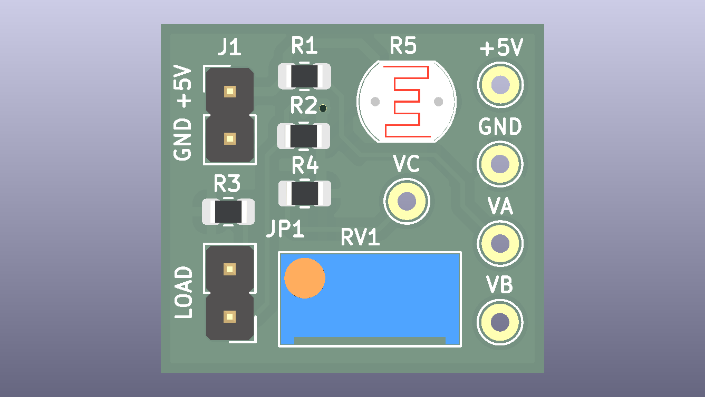
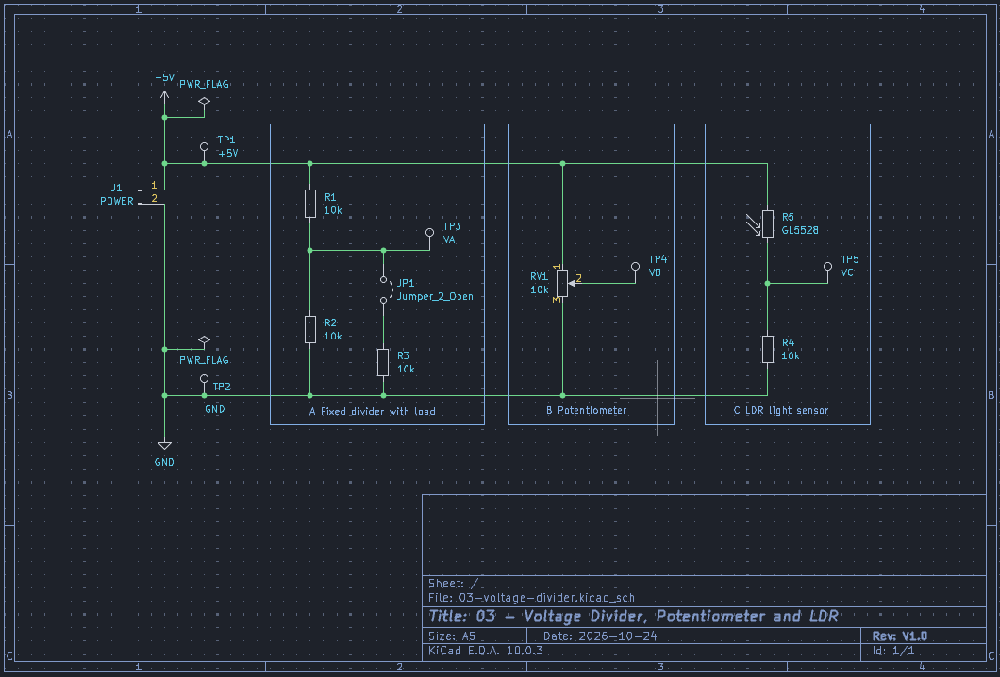
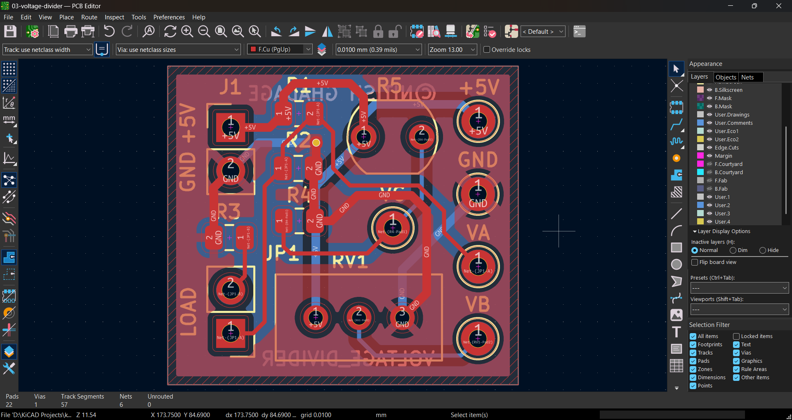
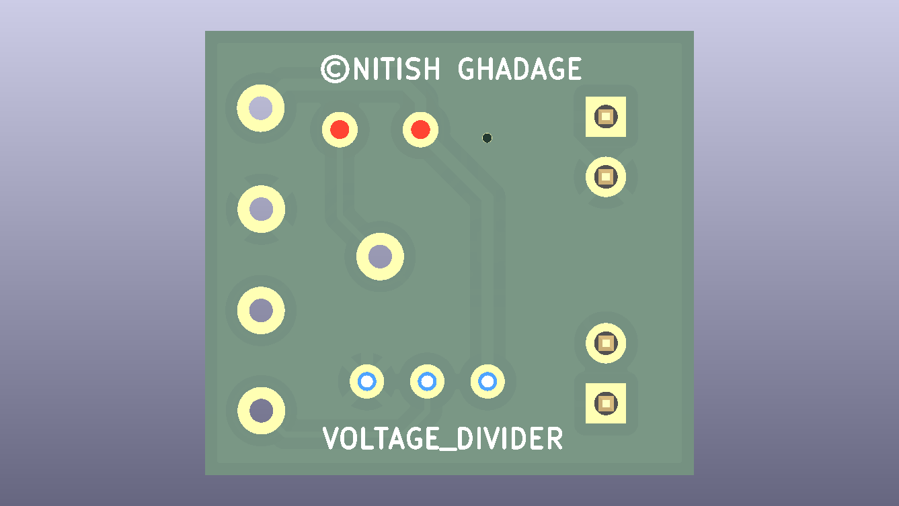
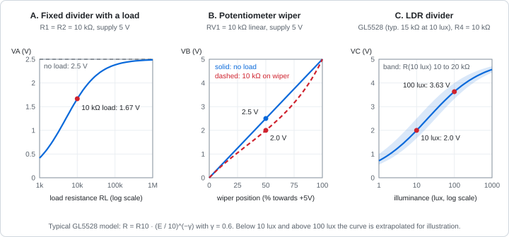
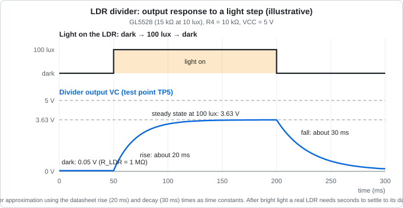

# Voltage Divider, Potentiometer and Light Sensor


> Three analog voltage dividers on one 5 V board: a fixed divider with a switchable load, a potentiometer, and a light-dependent resistor. Five test points make every voltage easy to measure.
> **Project 3** of my [KiCad learning path](../README.md): the voltage divider formula, the loading effect, the potentiometer and the LDR.



## Table of contents

- [Overview](#overview)
- [Key specifications](#key-specifications)
- [Gallery](#gallery)
- [Transfer curves and response](#transfer-curves-and-response)
- [How the circuits work](#how-the-circuits-work)
- [Design calculations (summary)](#design-calculations-summary)
- [Purpose of each component](#purpose-of-each-component)
- [Bill of materials](#bill-of-materials)
- [Netlist](#netlist)
- [Repository structure](#repository-structure)
- [Getting started](#getting-started)
- [Testing](#testing)
- [Verification status](#verification-status)
- [Future improvements](#future-improvements)
- [License](#license)

## Overview

Projects 1 and 2 produced outputs you could see: an LED that lit and an LED that blinked. This board produces **voltages you measure** with a multimeter. It teaches the most useful circuit in electronics, the voltage divider, in three forms:

| Section | Circuit | What it demonstrates |
|---|---|---|
| A | Fixed divider `R1` / `R2`, with a load `R3` switched in by jumper `JP1` | The divider formula, and how a load pulls the output down (the loading effect) |
| B | Potentiometer `RV1` across the supply | A variable divider, and how the wiper position sets the output |
| C | Light-dependent resistor `LDR1` and `R4` | Turning a changing resistance into a changing voltage |

New ideas compared with Project 2:

1. The voltage divider formula and its Thevenin equivalent
2. The loading effect, and why measuring a circuit can change it
3. A three-terminal potentiometer
4. A sensor whose resistance depends on light (power-law behaviour)
5. Test points for measurement
6. A jumper to change the circuit without soldering
7. Silkscreen graphics to group sections on the board

The full engineering write-up (theory, derivations, KiCad configuration, layout rules, test procedure) is in [`docs/DESIGN_NOTES.md`](docs/DESIGN_NOTES.md).

## Key specifications

| Parameter | Value |
|---|---|
| Supply voltage | 5 V DC via `J1` |
| Section A output `VA` (`TP3`) | 2.50 V unloaded, 1.67 V with `JP1` fitted |
| Section B output `VB` (`TP4`) | 0 V to 5 V, set by `RV1` |
| Section C output `VC` (`TP5`) | about 0.05 V in the dark, about 2 V at 10 lux, about 3.6 V at 100 lux (typical) |
| Supply current | about 0.95 mA typical, 1.29 mA maximum |
| Board layers | 2 |
| Board thickness | 1.6 mm |
| Copper weight | 1 oz (35 µm) |
| Board size | 70 × 40 mm |
| Components | 13 (8 circuit parts and 5 test points) |
| Pads / nets | 22 / 6 |
| Design tool | KiCad 10.0.x |
| ERC / DRC | 0 errors / 0 errors |

## Gallery

### Schematic



Full-size PDF: [`docs/schematic.pdf`](docs/schematic.pdf)

### PCB layout



### 3D views

| Top | Bottom |
|---|---|
|  |  |

## Transfer curves and response

### Transfer curves



| Plot | What it shows |
|---|---|
| A. Fixed divider | The output falls as the load resistance falls. With a 10 kΩ load (`JP1` fitted) it drops from 2.50 V to 1.67 V |
| B. Potentiometer | A straight line from 0 V to 5 V when unloaded. A 10 kΩ load on the wiper bends the curve (2.0 V instead of 2.5 V at mid-travel) |
| C. LDR divider | Output rises with light on a log scale. The shaded band is the part-to-part spread of the LDR (10 kΩ to 20 kΩ at 10 lux) |

### LDR response in time



When the light changes, the LDR follows with a lag of tens of milliseconds (datasheet: about 20 ms rising, 30 ms falling), so `VC` rises and falls smoothly rather than instantly. After bright light the real part can take seconds to settle back to its dark value. This diagram is an illustrative first-order approximation.

## How the circuits work

```
 +5V ──┬──────────────┬──────────────────┬──────────────┐
       R1 10k         │                  LDR1           │
       │              RV1 10k            │               │
 VA ───┼── JP1 ─ R3   │◄── wiper = VB    VC ──┬── TP5    │
       │         10k  │                       R4 10k     │
       R2 10k         │                       │          │
 GND ──┴──────────────┴───────────────────────┴──────────┘
```

**A. Fixed divider.** `R1` and `R2` form a series loop, so the same current flows through both. The output between them is the share of the supply that falls across `R2`. Fitting a shunt on `JP1` connects `R3` in parallel with `R2`, which lowers the lower half of the divider and pulls `VA` down.

**B. Potentiometer.** The two ends of `RV1` connect to `+5V` and `GND`. The wiper touches the track at an adjustable point and picks off the voltage there, so turning the shaft sweeps `VB` smoothly from 0 V to 5 V.

**C. LDR divider.** In the light the LDR's resistance is low, so most of the supply falls across `R4` and `VC` is high. In the dark the LDR's resistance is very high, so most of the supply falls across the LDR and `VC` is low.

## Design calculations (summary)

**Voltage divider:**

$$V_{out} = V_{in} \times \frac{R_2}{R_1 + R_2} \qquad V_A = 5.0\ \text{V} \times \frac{10\ \text{k}\Omega}{10\ \text{k}\Omega + 10\ \text{k}\Omega} = 2.50\ \text{V}$$

**Loading effect** (a load $R_L$ in parallel with $R_2$):

$$V_{A,loaded} = V_{in} \times \frac{R_2 \parallel R_L}{R_1 + (R_2 \parallel R_L)} = 5.0\ \text{V} \times \frac{5\ \text{k}\Omega}{10\ \text{k}\Omega + 5\ \text{k}\Omega} = 1.67\ \text{V}$$

**Potentiometer** (wiper at fraction $x$ of the travel, unloaded):

$$V_B = V_{in} \times x$$

**LDR divider** (LDR on the supply side):

$$V_C = V_{in} \times \frac{R_4}{R_4 + R_{LDR}} \qquad R_{LDR}(E) = R_{10}\left(\frac{E}{10\ \text{lux}}\right)^{-\gamma}$$

| Illuminance | `R_LDR` (typical: 15 kΩ at 10 lux, γ = 0.6) | `VC` |
|---|---|---|
| Dark (0 lux) | 1 MΩ or more | 0.05 V or less |
| 1 lux | 59.7 kΩ | 0.72 V |
| 10 lux | 15.0 kΩ | 2.00 V |
| 100 lux | 3.77 kΩ | 3.63 V |
| 1000 lux | 0.95 kΩ | 4.57 V |

The full derivations, tolerance analysis, loading tables and power checks are in [`docs/DESIGN_NOTES.md`](docs/DESIGN_NOTES.md#3-calculations).

## Purpose of each component

| Ref | Value | Purpose |
|---|---|---|
| `J1` | 2-pin header | Brings in 5 V (pin 1) and ground (pin 2) |
| `R1` | 10 kΩ | Upper resistor of the fixed divider |
| `R2` | 10 kΩ | Lower resistor of the fixed divider. Equal to `R1`, so `VA` is exactly half the supply |
| `R3` | 10 kΩ | Load resistor that `JP1` connects across `R2`, to demonstrate the loading effect |
| `JP1` | 2-pin header and shunt | Fitted: load connected. Removed: no load |
| `RV1` | 10 kΩ linear potentiometer | Variable divider. 10 kΩ draws only 0.5 mA and keeps the wiper impedance low |
| `LDR1` | GL5528 | Light sensor: 10 kΩ to 20 kΩ at 10 lux, at least 1 MΩ in the dark |
| `R4` | 10 kΩ | Fixed half of the LDR divider. Close to the LDR's resistance at typical room light, which gives good sensitivity |
| `TP1` | Test point | Probe point for `+5V` |
| `TP2` | Test point | Probe point for `GND` (reference for all measurements) |
| `TP3` | Test point | Probe point for `VA` |
| `TP4` | Test point | Probe point for `VB` |
| `TP5` | Test point | Probe point for `VC` |

## Bill of materials

| Ref | Qty | Value | Footprint | Description |
|---|---|---|---|---|
| `J1` | 1 | Conn_01x02_Pin | `PinHeader_1x02_P2.54mm_Vertical` | 2-pin header, 5 V in |
| `R1` | 1 | 10 kΩ | `R_0805_2012Metric` | Resistor, 1 % |
| `R2` | 1 | 10 kΩ | `R_0805_2012Metric` | Resistor, 1 % |
| `R3` | 1 | 10 kΩ | `R_0805_2012Metric` | Resistor, 1 % |
| `R4` | 1 | 10 kΩ | `R_0805_2012Metric` | Resistor, 1 % |
| `JP1` | 1 | Jumper_2_Open | `PinHeader_1x02_P2.54mm_Vertical` | 2-pin header, plus one 2.54 mm shunt |
| `RV1` | 1 | 10 kΩ | `Potentiometer_Bourns_3296W_Vertical` | Linear trimmer potentiometer |
| `LDR1` | 1 | GL5528 | `R_LDR_5.1x4.3mm_P3.4mm_Vertical` | CdS photoresistor, 5 mm |
| `TP1` to `TP5` | 5 | TestPoint | `TestPoint_THTPad_D2.0mm_Drill1.0mm` | Through-hole test points |

The same list is available as CSV in [`fabrication/bom.csv`](fabrication/bom.csv).

## Netlist

| Net | Connections |
|---|---|
| `+5V` | `J1`-1, `R1`-1, `RV1`-3, `LDR1`-1, `TP1` |
| `GND` | `J1`-2, `R2`-2, `R3`-2, `RV1`-1, `R4`-2, `TP2` |
| `VA` | `R1`-2, `R2`-1, `JP1`-1, `TP3` |
| `LOAD` | `JP1`-2, `R3`-1 |
| `VB` | `RV1`-2 (wiper), `TP4` |
| `VC` | `LDR1`-2, `R4`-1, `TP5` |

## Repository structure

This project lives in the `03-voltage-divider/` folder of the [kicad-learning-path](../README.md) repository.

```
03-voltage-divider/
├── README.md
├── 03_voltage_divider.kicad_pro     KiCad project file
├── 03_voltage_divider.kicad_sch     Schematic
├── 03_voltage_divider.kicad_pcb     PCB layout
├── fabrication/
│   ├── gerbers/                     Gerber and drill files
│   ├── 03_voltage_divider_gerbers.zip
│   └── bom.csv
└── docs/
    ├── DESIGN_NOTES.md              Full engineering documentation
    ├── schematic.pdf
    ├── images/                      Transfer curves, response diagram, screenshots, renders
    └── reports/                     ERC and DRC reports
```

## Getting started

### Open the project

1. Install [KiCad 10](https://www.kicad.org/download/).
2. Clone or download this repository.
3. Open `03-voltage-divider/03_voltage_divider.kicad_pro` in KiCad. The project uses only the standard KiCad libraries.

### Rebuild the manufacturing files

1. Open the PCB editor and run **Inspect → Design Rules Checker**. It should report 0 errors.
2. Open **File → Fabrication Outputs → Gerbers** and **Generate Drill Files**. The exact settings are listed in [`docs/DESIGN_NOTES.md`](docs/DESIGN_NOTES.md#9-manufacturing-outputs).
3. Zip the output folder.

### Order the PCB

Upload `fabrication/03_voltage_divider_gerbers.zip` to a PCB fabricator. Suggested options for a low-cost fab: 2 layers, 1.6 mm, 1 oz copper, HASL finish.

## Testing

Step-by-step measurements, expected values and a troubleshooting table are in [`docs/DESIGN_NOTES.md`](docs/DESIGN_NOTES.md#10-bring-up-and-testing). In short: apply 5 V, then use a multimeter on DC volts with the black probe on `TP2` and the red probe on `TP3`, `TP4` and `TP5`. You should read about 2.5 V (1.67 V with `JP1` fitted), a sweep from 0 V to 5 V as you turn `RV1`, and a voltage that follows the light on `LDR1`.

## Verification status

| Check | Result |
|---|---|
| Electrical Rules Check (ERC) | 0 errors |
| Design Rules Check (DRC) | 0 errors, 0 unrouted nets |
| Gerber viewer check | Passed |
| Physical board built and tested | Not yet |

Reports: [`docs/reports/`](docs/reports/)

## Future improvements

- Buffer the divider outputs with an op-amp (Project 7) so loading no longer matters
- Compare `VC` with the potentiometer voltage `VB` using a comparator (Project 8) to build a night-light with an adjustable threshold
- Add mounting holes
- Try a different LDR value and note how `R4` should change

## License

Released under the [MIT License](../LICENSE).

Author: **Nitish Ghadage** · [GitHub](https://github.com/nitu2126)
