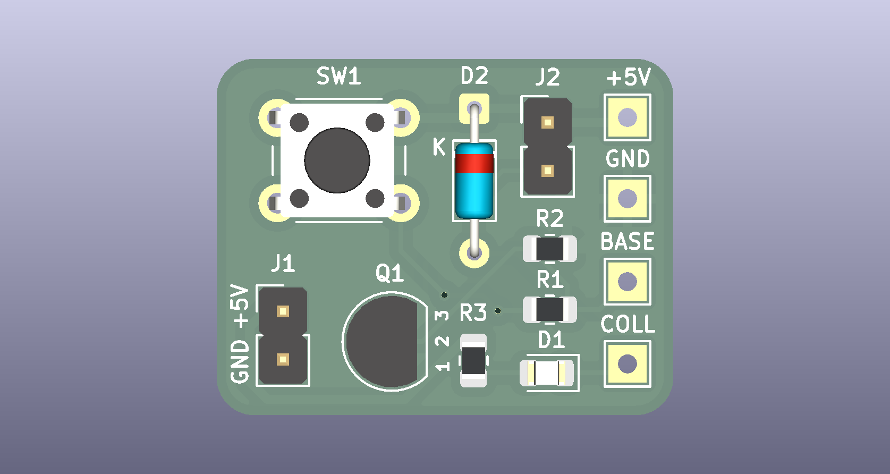
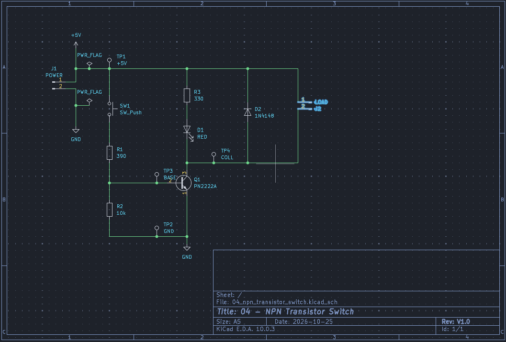
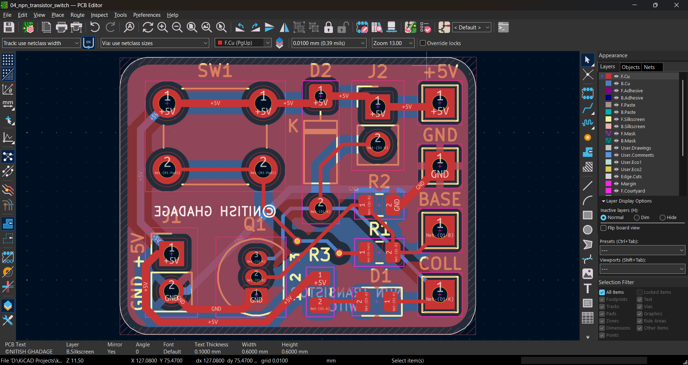
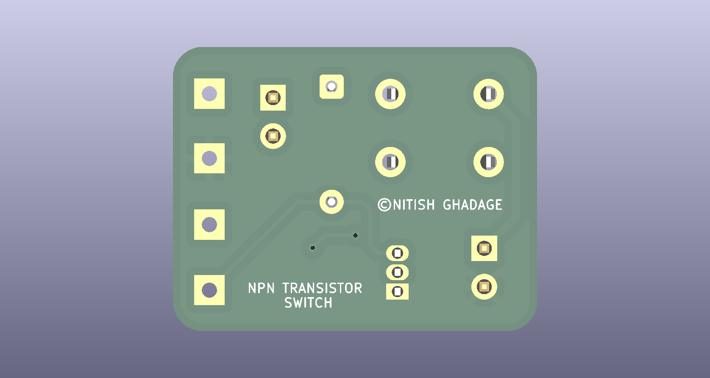

# NPN Transistor Switch


> A PN2222A NPN transistor that lets a push-button switch loads up to 75 mA at 5 V, with an LED indicator, a flyback diode and test points on the base and collector.
> **Project 4** of my [KiCad learning path](../README.md): the transistor as a switch, the base resistor, saturation and the flyback diode.



## Table of contents

- [Overview](#overview)
- [Key specifications](#key-specifications)
- [Gallery](#gallery)
- [Switching waveform and saturation curve](#switching-waveform-and-saturation-curve)
- [How the circuit works](#how-the-circuit-works)
- [Design calculations (summary)](#design-calculations-summary)
- [Purpose of each component](#purpose-of-each-component)
- [Bill of materials](#bill-of-materials)
- [Netlist](#netlist)
- [Repository structure](#repository-structure)
- [Getting started](#getting-started)
- [Testing](#testing)
- [Verification status](#verification-status)
- [Future improvements](#future-improvements)
- [License](#license)

## Overview

Project 1 let a button drive an LED directly. A button and its contacts cannot carry much current, and a microcontroller pin can supply only a few milliamps. A **transistor** solves this: a small base current controls a much larger collector current, so a weak signal can switch a real load.

| Part of the circuit | What it demonstrates |
|---|---|
| `Q1` with base resistor `R1` | A transistor driven hard into saturation so it acts like a closed switch |
| `R2` | A pull-down resistor that keeps the transistor firmly off when the button is released |
| `D1` and `R3` | An indicator LED that shows the switch is on, and adds a second load |
| `J2` and `D2` | An external load connector, and a flyback diode that protects the transistor from inductive spikes |
| `TP3` and `TP4` | Test points to measure the base and collector voltages |

New ideas compared with Project 3:

1. The NPN transistor, its three regions (cutoff, active, saturation) and its datasheet limits
2. Choosing a base resistor with a "forced gain" of 10 so saturation is guaranteed
3. Switching a load on its low side
4. Inductive loads and the flyback diode
5. A net class for a net that carries real current (`COLL`)
6. A switching waveform in the documentation

The full engineering write-up (theory, derivations, tolerance analysis, KiCad configuration, layout rules, test procedure) is in [`docs/DESIGN_NOTES.md`](docs/DESIGN_NOTES.md).

## Key specifications

| Parameter | Value |
|---|---|
| Supply voltage | 5 V DC via `J1` |
| Transistor | PN2222A (NPN, TO-92), 40 V, 600 mA |
| Switched load at `J2` | up to 75 mA at 5 V, low-side switched |
| Indicator LED current | 8.5 mA |
| Base drive current | 10.4 mA (forced gain 7.6 at the 68 Ω reference load, never above 8.75) |
| Saturation voltages | `VCE(sat)` about 0.2 V, `VBE` about 0.9 V |
| Flyback clamp voltage | about 5.9 V (supply plus one diode drop) |
| Supply current | about 0 mA released, 19 mA pressed with no external load, about 90 mA with the 68 Ω reference load |
| Board layers | 2 |
| Board thickness | 1.6 mm |
| Copper weight | 1 oz (35 µm) |
| Board size | 60 × 40 mm |
| Components | 13 (9 circuit parts and 4 test points) |
| Pads / nets | 25 / 6 |
| Design tool | KiCad 10.0.x |
| ERC / DRC | 0 errors / 0 errors |

## Gallery

### Schematic



Full-size PDF: [`docs/schematic.pdf`](docs/schematic.pdf)

### PCB layout



### 3D views

| Top | Bottom |
|---|---|
|  |  |

## Switching waveform and saturation curve

### Switching waveform


| Time | Event | Base (`TP3`) | Collector (`TP4`) | Load current |
|---|---|---|---|---|
| Before press | Button open, `R2` holds the base low | 0 V | 5.0 V (coil connected) | 0 |
| Button pressed | `R1` supplies 10.4 mA of base current | about 0.9 V | falls to about 0.2 V | rises with τ = L/R |
| Pressed, settled | Transistor saturated | about 0.9 V | about 0.2 V | 68.6 mA for a 70 Ω coil |
| Button released | Base current stops, the transistor turns off | 0 V | jumps to 5.9 V, clamped by `D2` | decays through `D2` in about 2.6 ms |
| After decay | Coil current has reached zero | 0 V | back to 5.0 V | 0 |

The diagram assumes a coil of 70 Ω and 100 mH, which is an illustration. The red dashed line marks what would happen without `D2`: the collector voltage would be limited only by breakdown.

### Saturation curve


The curve shows the collector voltage against base current for a 68 Ω load. With little base current the transistor is off (cutoff). As the current rises, the collector voltage falls along a slope set by the gain (active region). Beyond a small current it flattens at about 0.2 V (saturation). This circuit drives the base with 10.4 mA, 15 to 44 times the amount needed to just reach saturation, so the switch is firmly on whatever the gain of the individual transistor.

## How the circuit works

```
 +5V ──┬── SW1 ── R1 390 Ω ──┬── Q1 base
       │                      R2 10k to GND
       ├── R3 330 Ω ── D1 LED ──┐
       ├── J2 pin 1 (load +) ─┬─┤
       └── D2 cathode         │ ├── Q1 collector (COLL) ── J2 pin 2 (load −)
                              └─┘     D2 anode
                          Q1 emitter ── GND
```

1. **Released.** `R2` holds the base at 0 V. Without about 0.6 V between base and emitter the transistor conducts nothing, so the LED and the external load are off.
2. **Pressed.** `SW1` connects `+5V` to `R1`. About 10.4 mA flows into the base. That small current allows a much larger collector current: the LED branch (8.5 mA) and the external load (up to 75 mA) pull the collector down to about 0.2 V, so the load sees almost the full 5 V.
3. **Released again.** The base current stops and the transistor switches off. If the load is a coil (relay, solenoid, motor), its current cannot stop at once and tries to push the collector voltage up. `D2` conducts and gives that current a path back to the supply, clamping the collector at about 5.9 V.

The transistor sits on the **low side** of the load: the load connects between `+5V` and the collector, and the transistor connects the load to ground.

## Design calculations (summary)

**Base resistor.** Choose a collector current and a forced gain of 10 (the condition under which the datasheet guarantees `VCE(sat)`):

$$I_B = \frac{I_C}{10} = \frac{100\ \text{mA}}{10} = 10\ \text{mA} \qquad R_1 = \frac{V_{CC} - V_{BE(sat)}}{I_B} = \frac{5.0\ \text{V} - 1.0\ \text{V}}{10\ \text{mA}} = 400\ \Omega \;\rightarrow\; 390\ \Omega$$

**Actual base current:**

$$I_{R1} = \frac{5.0\ \text{V} - 0.9\ \text{V}}{390\ \Omega} = 10.51\ \text{mA} \qquad I_B = I_{R1} - \frac{0.9\ \text{V}}{10\ \text{k}\Omega} = 10.42\ \text{mA}$$

**Collector current** (68 Ω reference load plus the LED branch):

$$I_L = \frac{5.0 - 0.2}{68\ \Omega} = 70.6\ \text{mA} \qquad I_{LED} = \frac{5.0 - 2.0 - 0.2}{330\ \Omega} = 8.5\ \text{mA} \qquad I_C = 79.1\ \text{mA}$$

**Forced gain:** $I_C / I_B = 79.1 / 10.42 = 7.6$, below 10, so the transistor is saturated.

| Quantity | Value |
|---|---|
| Worst-case forced gain (tolerances, same supply voltage) | 8.75 at 4.75 V, 8.54 at 5.25 V |
| Largest total collector current with guaranteed saturation | 10 × 8.89 mA = 88.9 mA |
| `Q1` power | 25.2 mW (38 mW worst case), against 625 mW |
| `R1` power | 43.1 mW (56 mW worst case), against about 125 mW |
| Flyback clamp | 5.0 V + 0.9 V = 5.9 V, far below the transistor's 40 V rating |

The full derivation, datasheet values, tolerance cases and the flyback analysis are in [`docs/DESIGN_NOTES.md`](docs/DESIGN_NOTES.md#3-calculations).

## Purpose of each component

| Ref | Value | Purpose |
|---|---|---|
| `J1` | 2-pin header | Brings in 5 V (pin 1) and ground (pin 2) |
| `SW1` | 6 mm tactile push-button | The input: closing it sends current into the base |
| `R1` | 390 Ω, 1 % | Sets the base current to 10.4 mA, enough to saturate `Q1` with margin |
| `R2` | 10 kΩ, 1 % | Pull-down: keeps the base at 0 V when `SW1` is open, so stray pickup below 60 µA cannot turn `Q1` on |
| `Q1` | PN2222A | The switch. 40 V, 600 mA, gain 100 to 300 at 150 mA |
| `R3` | 330 Ω, 1 % | Limits the indicator LED current to 8.5 mA |
| `D1` | Red LED, 0805 | Indicator: lights when `Q1` is on |
| `J2` | 2-pin header | Connector for an external load (up to 75 mA at 5 V). Pin 1 is `+5V`, pin 2 is the switched side |
| `D2` | 1N4148 | Flyback diode across `J2`: carries the coil current when `Q1` turns off, and protects `Q1` |
| `TP1` | Test point | `+5V` |
| `TP2` | Test point | `GND`, the reference for all measurements |
| `TP3` | Test point | `BASE`: measure `VBE` and the base current through `R1` |
| `TP4` | Test point | `COLL`: measure `VCE(sat)` and the flyback clamp |

## Bill of materials

| Ref | Qty | Value | Footprint | Description |
|---|---|---|---|---|
| `J1` | 1 | Conn_01x02_Pin | `PinHeader_1x02_P2.54mm_Vertical` | 2-pin header, 5 V in |
| `J2` | 1 | Conn_01x02_Pin | `PinHeader_1x02_P2.54mm_Vertical` | 2-pin header, external load |
| `SW1` | 1 | SW_Push | `SW_PUSH_6mm` | 6 mm tactile push-button |
| `R1` | 1 | 390 Ω | `R_0805_2012Metric` | Base resistor, 1 % |
| `R2` | 1 | 10 kΩ | `R_0805_2012Metric` | Base pull-down, 1 % |
| `R3` | 1 | 330 Ω | `R_0805_2012Metric` | LED resistor, 1 % |
| `Q1` | 1 | PN2222A | `TO-92_Inline` | NPN transistor, pin order E-B-C |
| `D1` | 1 | RED | `LED_0805_2012Metric` | Red LED, 0805 |
| `D2` | 1 | 1N4148 | `D_DO-35_SOD27_P7.62mm_Horizontal` | Small-signal diode, flyback |
| `TP1` to `TP4` | 4 | TestPoint | `TestPoint_THTPad_D2.0mm_Drill1.0mm` | Through-hole test points |

The same list is available as CSV in [`fabrication/bom.csv`](fabrication/bom.csv).

## Netlist

| Net | Connections |
|---|---|
| `+5V` | `J1`-1, `SW1`-1, `R3`-1, `J2`-1, `D2` cathode, `TP1` |
| `GND` | `J1`-2, `Q1` emitter, `R2`-2, `TP2` |
| `BTN` | `SW1`-2, `R1`-1 |
| `BASE` | `R1`-2, `R2`-1, `Q1` base, `TP3` |
| `COLL` | `Q1` collector, `J2`-2, `D2` anode, `D1` cathode, `TP4` |
| `LEDA` | `R3`-2, `D1` anode |

## Repository structure

This project lives in the `04-npn-transistor-switch/` folder of the [kicad-learning-path](../README.md) repository.

```
04-npn-transistor-switch/
├── README.md
├── 04_npn_transistor_switch.kicad_pro     KiCad project file
├── 04_npn_transistor_switch.kicad_sch     Schematic
├── 04_npn_transistor_switch.kicad_pcb     PCB layout
├── fabrication/
│   ├── gerbers/                           Gerber and drill files
│   ├── 04_npn_transistor_switch_gerbers.zip
│   └── bom.csv
└── docs/
    ├── DESIGN_NOTES.md                    Full engineering documentation
    ├── schematic.pdf
    ├── images/                            Waveform, saturation curve, screenshots, renders
    └── reports/                           ERC and DRC reports
```

## Getting started

### Open the project

1. Install [KiCad 10](https://www.kicad.org/download/).
2. Clone or download this repository.
3. Open `04-npn-transistor-switch/04_npn_transistor_switch.kicad_pro` in KiCad. The project uses only the standard KiCad libraries.

### Rebuild the manufacturing files

1. Open the PCB editor and run **Inspect → Design Rules Checker**. It should report 0 errors.
2. Open **File → Fabrication Outputs → Gerbers** and **Generate Drill Files**. The exact settings are listed in [`docs/DESIGN_NOTES.md`](docs/DESIGN_NOTES.md#9-manufacturing-outputs).
3. Zip the output folder.

### Order the PCB

Upload `fabrication/04_npn_transistor_switch_gerbers.zip` to a PCB fabricator. Suggested options for a low-cost fab: 2 layers, 1.6 mm, 1 oz copper, HASL finish.

## Testing

Step-by-step measurements, expected values and a troubleshooting table are in [`docs/DESIGN_NOTES.md`](docs/DESIGN_NOTES.md#10-bring-up-and-testing). In short: apply 5 V and press `SW1`. The LED lights, `TP3` reads about 0.9 V, and `TP4` falls to a few tenths of a volt. Connect a 68 Ω, 1 W resistor to `J2` as a test load and check that `TP4` stays below 0.3 V.

## Verification status

| Check | Result |
|---|---|
| Electrical Rules Check (ERC) | 0 errors |
| Design Rules Check (DRC) | 0 errors, 0 unrouted nets |
| Gerber viewer check | Passed |
| Physical board built and tested | Not yet |

Reports: [`docs/reports/`](docs/reports/)

## Future improvements

- Replace `SW1` with a logic input so a microcontroller can drive the base (a 3.3 V signal gives a base current of about 6 mA, so `R1` would need to be smaller)
- Switch the same load with an N-MOSFET and compare the results (Project 12)
- Add a second stage to drive larger loads
- Add mounting holes

## License

Released under the [MIT License](../LICENSE).

Author: **Nitish Ghadage** · [GitHub](https://github.com/nitu2126)
