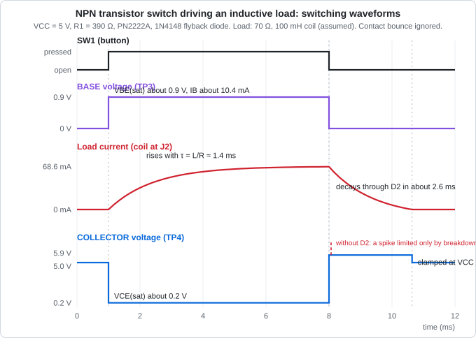
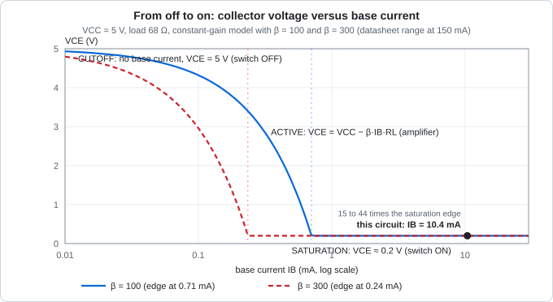

# Design Notes: NPN Transistor Switch

Revision 1.0 · KiCad 10.0.x · Last updated: 2026-10-24

This document records every engineering decision behind the board: the transistor theory, the calculations and tolerance analysis, the flyback-diode analysis, the switching waveform, the KiCad configuration, the layout rules, the verification results, the manufacturing settings and the test procedure.

## Contents

1. [Requirements](#1-requirements)
2. [Electronics background](#2-electronics-background)
3. [Calculations](#3-calculations)
4. [Switching waveform and saturation curve](#4-switching-waveform-and-saturation-curve)
5. [Schematic](#5-schematic)
6. [KiCad configuration](#6-kicad-configuration)
7. [Layout](#7-layout)
8. [Verification](#8-verification)
9. [Manufacturing outputs](#9-manufacturing-outputs)
10. [Bring-up and testing](#10-bring-up-and-testing)
11. [Lessons learned](#11-lessons-learned)
12. [References](#12-references)

---

## 1. Requirements

| # | Requirement |
|---|---|
| R1 | Powered from a 5 V DC source through a 2-pin header |
| R2 | A push-button switches an external load of up to 75 mA at 5 V, through a connector |
| R3 | The button carries only the small base current, not the load current |
| R4 | The transistor is fully saturated in every tolerance case, and fully off when the button is released |
| R5 | The transistor is protected from the voltage spike of an inductive load (relay, solenoid, motor) |
| R6 | An LED shows when the switch is on |
| R7 | Base and collector voltages can be measured with test points |
| R8 | Hand-solderable parts (through-hole and 0805 SMD) |
| R9 | 2-layer board that a low-cost fab can build without special options |
| R10 | Zero ERC errors and zero DRC errors |

---

## 2. Electronics background

### 2.1 The NPN bipolar transistor

A bipolar junction transistor has three terminals:

| Terminal | Role |
|---|---|
| Collector (C) | Where the load current enters |
| Base (B) | The control terminal |
| Emitter (E) | Where all the current leaves (here, ground) |

The base-emitter junction behaves like a diode. It starts to conduct at about 0.6 V to 0.7 V. A small base current $I_B$ then allows a much larger collector current $I_C$:

$$I_C = \beta \times I_B \qquad I_E = I_C + I_B$$

$\beta$ (written $h_{FE}$ in datasheets) is the DC current gain. It is not a precise number: it varies between parts, with current and with temperature. For the PN2222A the datasheet guarantees 100 to 300 at 150 mA and 10 V.

### 2.2 The three regions of operation

| Region | Condition | Behaviour | Use |
|---|---|---|---|
| Cutoff | $V_{BE}$ below about 0.6 V | $I_C \approx 0$ (nanoamps of leakage) | Switch OFF |
| Active | $V_{BE}$ about 0.65 V, $I_B$ small | $I_C = \beta I_B$, $V_{CE}$ in between | Amplifier |
| Saturation | $I_B$ larger than $I_C / \beta$ | $V_{CE}$ is small (about 0.2 V), $I_C$ is set by the load | Switch ON |

A switch must live in cutoff and saturation, and pass through the active region as fast as possible.

### 2.3 Forced gain and saturation

In saturation the collector current is set by the load, not by the transistor. The ratio actually used is the **forced gain**:

$$\beta_{forced} = \frac{I_C}{I_B}$$

Datasheets specify $V_{CE(sat)}$ at a forced gain of 10. Designing for $\beta_{forced} \le 10$ guarantees a small $V_{CE(sat)}$ for any transistor, whatever its true gain (100 or 300). This is the standard base-resistor rule: **choose $I_B \ge I_C / 10$.**

### 2.4 The base resistor and the pull-down

The base-emitter junction is a diode, so a voltage source connected straight to the base would drive a huge current. A **base resistor** $R_1$ sets the current:

$$I_{R1} = \frac{V_{drive} - V_{BE}}{R_1}$$

A **pull-down resistor** $R_2$ from base to ground keeps the base at 0 V when nothing drives it. Without it, the base floats when the button is open and could pick up interference and turn the transistor on. With $R_2$ = 10 kΩ, stray current below $0.6\ \text{V} / 10\ \text{k}\Omega = 60\ \mu\text{A}$ cannot reach the 0.6 V needed to turn the transistor on.

### 2.5 Low-side switching

The load sits between `+5V` and the collector, and the transistor connects the load's other end to ground. This is called **low-side** switching. It is the natural arrangement for an NPN transistor, and it needs a base voltage of only 0.9 V.

### 2.6 Inductive loads and the flyback diode

The voltage across an inductor is:

$$V_L = L\,\frac{dI}{dt}$$

The current in a coil cannot change instantly, and it stores energy:

$$E = \tfrac{1}{2}\,L\,I^2 = \tfrac{1}{2} \times 0.1\ \text{H} \times (68.6\ \text{mA})^2 = 0.235\ \text{mJ}$$

When the transistor opens, the coil current is forced to fall in a few tens of nanoseconds (the transistor's fall time is 60 ns). The coil responds with a very large reverse voltage. For $L$ = 100 mH and $\Delta I$ = 68.6 mA over 60 ns the formula gives:

$$V = 0.1\ \text{H} \times \frac{0.0686\ \text{A}}{60\ \text{ns}} \approx 114\ \text{kV}$$

This is a theoretical figure. In practice the voltage rises until something breaks down, usually the transistor (rated 40 V) or the air gap at a contact.

A **flyback diode** `D2` is connected across the load with its cathode to the supply and its anode to the collector. Normally it is reverse-biased and invisible. When the transistor opens, the coil pushes the collector above the supply, `D2` conducts, and the coil current circulates through the diode:

$$V_{COLL} = V_{CC} + V_F \approx 5.0\ \text{V} + 0.9\ \text{V} = 5.9\ \text{V}$$

The spike is clamped at 5.9 V, far below the transistor's 40 V rating. The current then decays as the diode drop and the coil resistance dissipate the stored energy.

### 2.7 Datasheet limits

**PN2222A** (onsemi PN2222/D, TO-92):

| Parameter | Value |
|---|---|
| $V_{CEO}$, $V_{CBO}$, $V_{EBO}$ | 40 V, 75 V, 6 V |
| Collector current, continuous | 600 mA |
| Total power at 25 °C | 625 mW (derate 5 mW/°C) |
| Thermal resistance, junction to ambient | 200 °C/W |
| DC gain $h_{FE}$ at $I_C$ = 150 mA, $V_{CE}$ = 10 V | 100 minimum, 300 maximum |
| $V_{CE(sat)}$ at 150 mA, $I_B$ = 15 mA | 0.3 V maximum |
| $V_{CE(sat)}$ at 500 mA, $I_B$ = 50 mA | 1.0 V maximum |
| $V_{BE(sat)}$ at 150 mA, $I_B$ = 15 mA | 0.6 V to 1.2 V |
| Switching times (30 V, 150 mA) | delay 10 ns, rise 25 ns, storage 225 ns, fall 60 ns |
| Leakage $I_{CEX}$ | 10 nA maximum |
| TO-92 pinout | Pin 1 emitter, pin 2 base, pin 3 collector |

**1N4148** (Vishay):

| Parameter | Value |
|---|---|
| Repetitive peak reverse voltage | 100 V (continuous reverse voltage 75 V) |
| Forward continuous current | 300 mA |
| Repetitive peak forward current | 500 mA |
| Peak forward surge (1 µs) | 2 A |
| Forward voltage at 10 mA | 1 V maximum |
| Reverse recovery time | 4 ns |

**Pinout warning.** Many other small NPN transistors (for example the BC547) have the pin order collector-base-emitter, the reverse of the PN2222A. Always check the datasheet before substituting a part, and rotate the symbol and footprint accordingly.

---

## 3. Calculations

### 3.1 Inputs

| Symbol | Meaning | Value | Source |
|---|---|---|---|
| $V_{CC}$ | Supply voltage | 5.0 V (4.75 V to 5.25 V) | Requirement R1 |
| $I_{L,max}$ | Maximum external load current | 75 mA | Requirement R2 |
| $I_{LED}$ | Indicator LED branch | about 8.5 mA | See 3.5 |
| $I_{C,design}$ | Design collector current | 100 mA | 75 mA + LED, rounded up |
| $\beta_{forced}$ | Forced gain target | 10 | Datasheet test condition |
| $V_{BE(sat)}$ | Base-emitter voltage | 0.9 V (1.0 V used for the design) | Datasheet range 0.6 V to 1.2 V |
| $V_{CE(sat)}$ | Collector-emitter voltage | 0.2 V | Datasheet maximum 0.3 V at forced gain 10 |
| $V_F$ (LED) | LED forward voltage | 2.0 V | Typical red LED |

### 3.2 Base resistor

$$I_B = \frac{I_{C,design}}{\beta_{forced}} = \frac{100\ \text{mA}}{10} = 10\ \text{mA}$$

$$R_1 = \frac{V_{CC} - V_{BE(sat)}}{I_B} = \frac{5.0\ \text{V} - 1.0\ \text{V}}{10\ \text{mA}} = 400\ \Omega \;\rightarrow\; 390\ \Omega\ \text{(standard E12 value)}$$

Rounding down gives slightly more base current, which errs on the side of saturation.

### 3.3 Actual base current

$$I_{R1} = \frac{5.0\ \text{V} - 0.9\ \text{V}}{390\ \Omega} = 10.51\ \text{mA}$$

$$I_{R2} = \frac{0.9\ \text{V}}{10\ \text{k}\Omega} = 0.09\ \text{mA} \qquad I_B = I_{R1} - I_{R2} = 10.42\ \text{mA}$$

`R2` steals less than 1 % of the base current.

### 3.4 Collector current with the reference load

The reference load is a 68 Ω, 1 W resistor connected to `J2` (a stand-in for a 70 mA coil):

$$I_L = \frac{V_{CC} - V_{CE(sat)}}{R_L} = \frac{5.0 - 0.2}{68\ \Omega} = 70.6\ \text{mA}$$

### 3.5 Indicator LED branch

$$I_{LED} = \frac{V_{CC} - V_F - V_{CE(sat)}}{R_3} = \frac{5.0 - 2.0 - 0.2}{330\ \Omega} = 8.49\ \text{mA}$$

The LED current also flows through the collector, so it is added to the load current:

$$I_C = I_L + I_{LED} = 70.6 + 8.5 = 79.1\ \text{mA}$$

### 3.6 Saturation check

$$\beta_{forced} = \frac{I_C}{I_B} = \frac{79.1\ \text{mA}}{10.42\ \text{mA}} = 7.6 \quad (\le 10,\ \text{so the transistor is saturated})$$

**Saturation margin.** The base current that only just saturates the transistor with the 68 Ω load is $I_B = (V_{CC} - V_{CE(sat)}) / (R_L \beta)$:

| Transistor gain | Saturation edge | Actual $I_B$ is |
|---|---|---|
| β = 100 (datasheet minimum) | 0.71 mA | 14.8 times more |
| β = 300 (datasheet maximum) | 0.24 mA | 44.3 times more |

### 3.7 Worst-case analysis

Assumptions: resistors 1 %, $V_{BE}$ from 0.6 V to 1.2 V, LED $V_F$ 1.8 V to 2.2 V, $V_{CE(sat)}$ from 0.1 V to 0.3 V. The supply voltage is the same for both the base and collector currents in each case, because they come from the same supply.

| Case | `VCC` | Base current $I_B$ (minimum) | Collector current $I_C$ (maximum) | Forced gain |
|---|---|---|---|---|
| Nominal | 5.00 V | 10.42 mA | 79.07 mA | 7.59 |
| Low supply | 4.75 V | 8.89 mA | 77.80 mA | 8.75 |
| High supply | 5.25 V | 10.16 mA | 86.75 mA | 8.54 |

In every case the forced gain stays below 10. The base current also stays between 8.89 mA and 11.98 mA across all cases.

**Maximum total collector current for guaranteed saturation:** $10 \times 8.89\ \text{mA} = 88.9\ \text{mA}$. With the LED branch taking about 9 mA, the external load limit of 75 mA leaves margin.

### 3.8 Power and ratings

| Part | Power (nominal) | Power (worst case) | Rating | Utilised |
|---|---|---|---|---|
| `Q1` | 25.2 mW (0.2 V × 79.1 mA + 0.9 V × 10.4 mA) | 38.2 mW | 625 mW | 6 % at worst case |
| `R1` | 43.1 mW | 56.0 mW | about 125 mW (0805) | 45 % at worst case |
| `R2` | 0.08 mW | negligible | about 125 mW | negligible |
| `R3` | 23.8 mW | 34 mW | about 125 mW | 27 % |
| `D1` | 17.0 mW | | | |
| Reference load, 68 Ω | 339 mW | | 1 W (external resistor) | 34 % |

Transistor temperature rise: $\Delta T = P \times R_{\theta JA} = 25.2\ \text{mW} \times 200\ ^\circ\text{C/W} \approx 5\ ^\circ\text{C}$ (7.6 °C at worst case). The transistor stays barely warm and needs no heatsink.

### 3.9 Supply current

| State | Supply current | Power at 5 V |
|---|---|---|
| Button released | about 0 mA (leakage in nanoamps) | 0 mW |
| Pressed, no external load | $I_{R1} + I_{LED} = 10.5 + 8.5 = 19.0$ mA | 95 mW |
| Pressed, 68 Ω reference load | 10.5 + 70.6 + 8.5 = 89.6 mA | 448 mW |

`SW1` carries only the 10.5 mA base current, a small fraction of the 90 mA the load draws. This is the point of the circuit.

### 3.10 Flyback diode

| Quantity | Value | Limit |
|---|---|---|
| Peak diode current (coil of 70 Ω, 5 V) | 68.6 mA | 300 mA continuous, 500 mA repetitive |
| Diode forward voltage at that current | about 0.9 V (assumed) | |
| Collector clamp voltage | 5.9 V | 40 V ($V_{CEO}$ of the transistor) |
| Reverse voltage across the diode in normal operation | 4.8 V | 75 V |
| Decay time of the coil current ($L$ = 100 mH, assumed) | 2.64 ms | |

Decay time: with the diode drop as the discharge voltage, the current is $I(t) = (I_0 + V_F/R)\,e^{-t/\tau} - V_F/R$ with $\tau = L/R = 1.43$ ms. Setting $I(t) = 0$ gives $t = \tau \ln(1 + I_0 R / V_F) = 2.64$ ms.

### 3.11 Choosing other loads

| Load | Check |
|---|---|
| Resistive (lamp, heater) | Current at 5 V must be 75 mA or less |
| Relay | Coil current at 5 V must be 75 mA or less. Check the coil resistance in its datasheet |
| Active buzzer | Typically 10 mA to 30 mA, well within the limit |
| Small fan or motor | Start-up current is often several times the running current. Measure it first and stay under 75 mA |
| Anything over 75 mA | Use a MOSFET (Project 12) or a larger transistor with a smaller `R1` |

### 3.12 Component purposes

| Ref | Value | Purpose |
|---|---|---|
| `J1` | 2-pin header | Brings in 5 V and ground |
| `SW1` | Tactile switch | Input: closing it sends current into the base |
| `R1` | 390 Ω | Sets the base current to 10.4 mA |
| `R2` | 10 kΩ | Keeps the base at 0 V when the button is open |
| `Q1` | PN2222A | The switch |
| `R3` | 330 Ω | Limits the indicator LED current |
| `D1` | Red LED | Shows the switch is on |
| `J2` | 2-pin header | External load connector |
| `D2` | 1N4148 | Flyback diode |
| `TP1` to `TP4` | Test points | `+5V`, `GND`, `BASE`, `COLL` |

---

## 4. Switching waveform and saturation curve

### 4.1 Switching waveform

The diagram shows four signals over time for a coil load (70 Ω, 100 mH, assumed).

| Signal | Shape | Explanation |
|---|---|---|
| `SW1` | Steps up at the press, down at the release | The input |
| `BASE` | 0 V, then 0.9 V while pressed | The base-emitter junction clamps the voltage at about 0.9 V in saturation |
| Load current | Rises exponentially, then decays | A coil resists changes in current: rise time constant $L/R$ = 1.43 ms, 99 % after about 6.6 ms |
| `COLL` | 5.0 V, falls to 0.2 V, rises to 5.9 V, settles at 5.0 V | Saturation drops it to 0.2 V. At turn-off `D2` clamps it at $V_{CC} + V_F$ |

Transistor switching times (turn-on about 35 ns, turn-off about 285 ns, from the delay, rise, storage and fall times in section 2.7) are far shorter than the 1.4 ms coil time constant, so they do not appear on this time scale. They matter for fast PWM (Project 12).

A real button also **bounces**: its contacts open and close several times for a few milliseconds. The load will chatter during that time. Project 10 deals with this.

### 4.2 Saturation curve

The plot shows $V_{CE}$ against $I_B$ for a 68 Ω load with $V_{CE} = \max(V_{CE(sat)},\ V_{CC} - \beta I_B R_L)$.

| Region | What happens |
|---|---|
| Cutoff | No base current, so $V_{CE}$ = 5 V |
| Active | $V_{CE}$ falls linearly with $I_B$, at a slope set by β |
| Saturation | $V_{CE}$ flattens at about 0.2 V. More base current gains nothing |

With β = 100 the saturation edge is at 0.71 mA, and with β = 300 it is at 0.24 mA. The design drives 10.4 mA, so the result does not depend on which transistor you happen to get. The constant-β model is an approximation, because real gain varies with current and temperature.

---

## 5. Schematic

### 5.1 Symbols and footprints

| Ref | Library symbol | Value | Footprint |
|---|---|---|---|
| `J1` | `Connector:Conn_01x02_Pin` | Conn_01x02_Pin | `Connector_PinHeader_2.54mm:PinHeader_1x02_P2.54mm_Vertical` |
| `J2` | `Connector:Conn_01x02_Pin` | LOAD | `Connector_PinHeader_2.54mm:PinHeader_1x02_P2.54mm_Vertical` |
| `SW1` | `Switch:SW_Push` | SW_Push | `Button_Switch_THT:SW_PUSH_6mm` |
| `R1` | `Device:R` | 390 | `Resistor_SMD:R_0805_2012Metric` |
| `R2` | `Device:R` | 10k | `Resistor_SMD:R_0805_2012Metric` |
| `R3` | `Device:R` | 330 | `Resistor_SMD:R_0805_2012Metric` |
| `Q1` | `Transistor_BJT:PN2222A` | PN2222A | `Package_TO_SOT_THT:TO-92_Inline` |
| `D1` | `Device:LED` | RED | `LED_SMD:LED_0805_2012Metric` |
| `D2` | `Diode:1N4148` | 1N4148 | `Diode_THT:D_DO-35_SOD27_P7.62mm_Horizontal` |
| `TP1` to `TP4` | `Connector:TestPoint` | TP1 to TP4 | `TestPoint:TestPoint_THTPad_D2.0mm_Drill1.0mm` |
| Power | `power:+5V`, `power:GND`, `power:PWR_FLAG` ×2 | n/a | n/a |

Check the symbol's pin numbers against the datasheet: the PN2222A in TO-92 is pin 1 emitter, pin 2 base, pin 3 collector. If your library has no PN2222A symbol, use `Device:Q_NPN_EBC`, which has the same E-B-C pin order.

### 5.2 Nets

| Net | Connections |
|---|---|
| `+5V` | `J1`-1, `SW1`-1, `R3`-1, `J2`-1, `D2` cathode, `TP1` |
| `GND` | `J1`-2, `Q1` emitter, `R2`-2, `TP2` |
| `BTN` | `SW1`-2, `R1`-1 |
| `BASE` | `R1`-2, `R2`-1, `Q1` base, `TP3` |
| `COLL` | `Q1` collector, `J2`-2, `D2` anode, `D1` cathode, `TP4` |
| `LEDA` | `R3`-2, `D1` anode |

### 5.3 Design decisions

- **`R2` close to `Q1`.** The pull-down must sit at the base to be effective, so it connects between the `BASE` net and `GND`.
- **`D2` oriented against the supply.** Cathode to `+5V`, anode to `COLL`. It is reverse-biased in normal operation. If it were reversed, it would short the load to the supply.
- **`J2` pin 1 is `+5V`.** Pin 2 is the switched side. Do not connect an external supply to `J2`.
- **Net labels** `BTN`, `BASE`, `COLL` and `LEDA` name the important nodes. `TP3` and `TP4` attach to `BASE` and `COLL`.
- **`PWR_FLAG`** on `+5V` and `GND` tells ERC that both nets are driven by an external supply.
- **The LED branch shares the collector.** Its current adds to the load current and has been included in every calculation.

### 5.4 Schematic conventions

- Signal flows left to right, positive supply at the top, ground at the bottom.
- The input (`SW1`, `R1`, `R2`) is on the left, the transistor in the middle, and the loads (`J2`, `D2`, `R3`, `D1`) at the top right.
- Reference and value fields are visible and not overlapping.
- Schematic grid: 1.27 mm (50 mil).
- The title block is filled in (title, date, revision, author).

---

## 6. KiCad configuration

### 6.1 Project creation

1. Create the folder `04-npn-transistor-switch` inside the repository.
2. In KiCad, choose **File → New Project**, browse to that folder, name the project `04_npn_transistor_switch`, and untick "Create a new folder for the project".

### 6.2 Board setup

Import the settings from the previous board: in the PCB editor, open **File → Board Setup**, click **Import Settings from Another Board…**, select `03_voltage_divider.kicad_pcb`, tick the stackup, design rules, net classes and text defaults, and confirm.

| Setting | Value |
|---|---|
| Copper layers | 2, board thickness 1.6 mm, 1 oz copper |
| Minimum clearance | 0.2 mm |
| Minimum track width | 0.2 mm |
| Minimum connection width | 0.2 mm |
| Minimum annular width | 0.15 mm |
| Minimum via diameter | 0.6 mm |
| Copper to hole clearance | 0.3 mm |
| Copper to edge clearance | 0.5 mm |
| Minimum drill size | 0.3 mm |
| Hole to hole clearance | 0.5 mm |
| Silkscreen: minimum clearance / text height / text thickness | 0.15 mm / 1.0 mm / 0.15 mm |

### 6.3 Net classes (new in this project)

Open **Board Setup → Design Rules → Net Classes**. The `Power` class from earlier projects gets a third net, because `COLL` carries the load current.

| Net class | Clearance | Track width | Via diameter / drill | Net patterns |
|---|---|---|---|---|
| `Default` | 0.2 mm | 0.25 mm | 0.6 mm / 0.3 mm | all others (`BTN`, `BASE`, `LEDA`) |
| `Power` | 0.2 mm | 0.5 mm | 0.8 mm / 0.4 mm | `+5V`, `GND`, `COLL` |

Add the pattern `COLL` to the `Power` class in the pattern assignment table on the same page. The base and button nets carry about 10 mA, so 0.25 mm is more than enough.

**Why not narrower?** The IPC-2221 estimate for a 1 oz outer-layer track at a 10 °C rise is about 0.9 A for 0.25 mm and 1.4 A for 0.5 mm. The collector net carries up to about 90 mA, so either would work. The wider track is used because it costs nothing and lowers the resistance and heating.

### 6.4 Grid

PCB grid: 0.5 mm for placement, 0.25 mm or 0.1 mm for routing.

---

## 7. Layout

### 7.1 Outline

A rectangle on `Edge.Cuts`, **60 × 40 mm**, with 3 mm corner radius. The outline is a single closed shape with no gaps.

### 7.2 Placement

| Rule | Reason |
|---|---|
| Input on the left (`SW1`, `R1`, `R2`), transistor in the middle, load connector `J2` at the right edge | Signal flows left to right as in the schematic |
| `J1` at the left edge, `J2` at the right edge | Short, separate power-in and load-out paths |
| `R2` immediately beside `Q1`, between base and emitter | The pull-down must sit at the base |
| `D2` as close as possible to the `J2` pins | The diode must clamp at the load, with the shortest loop |
| `R3` and `D1` near `Q1` and the top edge, with the LED visible | Indicator is easy to see |
| `TP1` to `TP4` in a row along the bottom edge, 5.08 mm pitch, in the order `+5V`, `GND`, `BASE`, `COLL` | Probe-friendly, with `GND` next to the signals |
| `Q1` oriented with its flat face towards the board centre and the pin order clearly marked on the silkscreen | Reduces the chance of fitting it backwards |

### 7.3 Routing

| Rule | Value |
|---|---|
| `BTN`, `BASE`, `LEDA` track width | 0.25 mm |
| `+5V`, `GND`, `COLL` track width | 0.5 mm (the `Power` net class applies this) |
| Corner angles | 45° or curved, never 90° |
| Copper to board edge | at least 0.5 mm |
| Via size | 0.6 mm pad / 0.3 mm drill |

**Current loops.** Two loops matter:

1. The **load loop**: `+5V` → `J2` → `Q1` collector → emitter → `GND` → back to `J1`. Keep it short and wide.
2. The **flyback loop**: `D2` → `J2` → back to `D2`. Keep this as short as possible so the diode clamps the spike where it is generated.

**TO-92 pads.** The `TO-92_Inline` footprint has its pads on a 1.27 mm pitch, which leaves a gap of only about 0.22 mm between neighbouring pads, just above the 0.2 mm clearance rule. Route out from the ends of the pads, and do not try to pass a track between them. If your DRC reports a clearance error on `Q1`, use the `TO-92_Inline_Wide` footprint (2.54 mm lead spacing, with the leads bent) instead.

### 7.4 Ground pour and stitching vias

- A `GND` zone on both `F.Cu` and `B.Cu`. The bottom layer is kept as a nearly continuous ground plane.
- The surface-mount parts with ground pads (`R2`) connect to the top-layer pour. A few **stitching vias** (0.6 mm / 0.3 mm), roughly every 10 mm to 15 mm, tie the two pours together. Select each via and confirm its net is `GND`.
- `Q1`'s emitter connects to the ground pour through a short, direct connection.
- Refill zones (press `B`) before every DRC run and before plotting.

### 7.5 Silkscreen

- Reference designators 1.0 mm to 1.5 mm tall, with stroke at least 0.15 mm.
- Pin labels next to `Q1`: `E`, `B`, `C`.
- Diode polarity: the stripe (cathode) of `D2` is shown clearly.
- `J1`: pin 1 marked `+5V`. `J2`: `+5V` at pin 1 and `SW` at pin 2.
- Test point labels `+5V`, `GND`, `BASE`, `COLL`.
- A label `PRESS` at `SW1`, plus the board name, version, date and author.
- No text over pads, and kept at least 0.5 mm from the board edge.

---

## 8. Verification

| Check | How | Result |
|---|---|---|
| ERC | Schematic editor → Inspect → Electrical Rules Checker | 0 errors |
| DRC | PCB editor → Inspect → Design Rules Checker | 0 errors, 0 unrouted |
| Board statistics | PCB editor status bar | 25 pads, 6 nets |
| 3D view | PCB editor → View → 3D Viewer (Alt+3) | `Q1` and `D2` orientation correct |
| Gerber check | Third-party viewer (KiCad Gerber Viewer, Gerbv, tracespace) | Outline closed, holes aligned, silkscreen clear of pads |

Saved reports are in [`reports/`](reports/).

---

## 9. Manufacturing outputs

### 9.1 Gerber plot settings (File → Fabrication Outputs → Gerbers)

| Setting | Value |
|---|---|
| Output directory | `fabrication/gerbers` |
| Layers | `F.Cu`, `B.Cu`, `F.Paste`, `B.Paste`, `F.Silkscreen`, `B.Silkscreen`, `F.Mask`, `B.Mask`, `Edge.Cuts` |
| Use Protel filename extensions | On |
| Subtract soldermask from silkscreen | On |
| Check zone fills before plotting | On |
| Coordinate format | 4.6, unit mm |
| Use extended X2 format | On |
| Include netlist attributes | On |
| Disable aperture macros | Off |
| Use drill/place file origin | Off |
| Plot drawing sheet | Off |

### 9.2 Drill file settings

| Setting | Value |
|---|---|
| Drill file format | Excellon |
| Oval holes drill mode | Use alternate drill mode |
| Drill origin | Absolute |
| Drill units | Millimetres |
| Zeros format | Decimal format |
| Map file format (optional) | Gerber |

### 9.3 Suggested fab order options

| Option | Value |
|---|---|
| Layers | 2 |
| Thickness | 1.6 mm |
| Outer copper weight | 1 oz |
| Surface finish | HASL (lead-free if available) |
| Quantity | Fab minimum |

Verify the generated files in a Gerber viewer, zip the `gerbers` folder, and upload the zip.

---

## 10. Bring-up and testing

### 10.1 Before powering

1. Solder the 0805 parts first, then `D2`, the headers, test points, `SW1` and finally `Q1`.
2. Check the orientation of `Q1` (E-B-C as marked), `D1` (cathode towards `COLL`) and `D2` (stripe towards `+5V`).
3. With a multimeter in continuity mode, confirm there is **no short** between `+5V` and `GND`.

### 10.2 Test load

For the reference measurements, connect a **68 Ω, 1 W resistor** between the pins of `J2`. This draws about 70 mA, similar to a 5 V relay coil. A resistor has no inductance, so it will not show the flyback spike. Do not remove `D2` when an inductive load is connected, because the spike can destroy `Q1`.

### 10.3 Powered test

Set the multimeter to DC volts. Keep the black probe on `TP2` (`GND`) unless noted.

1. Apply 5 V to `J1` (pin 1 = +5 V, pin 2 = GND). Measure `TP1`: this is your actual supply voltage.
2. Without pressing: `TP3` should read about 0 V and the LED should be off.
3. Press and hold `SW1`: the LED lights.
4. Measure `TP3` (`BASE`): about 0.9 V.
5. Measure `TP4` (`COLL`): with no external load it is below 0.2 V; with the 68 Ω load it is about 0.1 V to 0.3 V.
6. Calculate the base current from the voltage across `R1`: $I_{R1} = (V_{TP1} - V_{TP3}) / 390\ \Omega$, then subtract $V_{TP3} / 10\ \text{k}\Omega$.
7. Calculate the load current: $I_L = (V_{TP1} - V_{TP4}) / 68\ \Omega$.
8. Calculate the forced gain: $(I_L + I_{LED}) / I_B$, which should be below 10.
9. Touch the transistor: it should be barely warm.

| Measurement | Expected | Measured |
|---|---|---|
| Supply at `TP1` | 5.0 V (4.75 V to 5.25 V) | |
| `TP3`, released | about 0 V | |
| `TP3`, pressed | 0.8 V to 1.0 V | |
| `TP4`, pressed, no external load | below 0.2 V | |
| `TP4`, pressed, 68 Ω load | 0.1 V to 0.3 V | |
| `TP4`, released, 68 Ω load connected | about 5 V | |
| Voltage across `R1` (`TP1` − `TP3`) | about 4.1 V (base current branch 10.5 mA) | |
| Voltage across the 68 Ω load | about 4.8 V (load current about 70 mA) | |
| Calculated forced gain | about 7.6 (below 10) | |
| Supply current, pressed, 68 Ω load | about 90 mA | |
| Supply current, released | about 0 mA | |

If you have an oscilloscope and a 5 V relay or small solenoid, connect it to `J2`, probe `TP4`, and trigger on a rising edge. When you release the button you should see the collector jump to about 5.9 V and stay there for a few milliseconds before returning to 5 V.

### 10.4 Troubleshooting

| Symptom | Likely cause |
|---|---|
| LED always on | `Q1` shorted collector to emitter, or `Q1` fitted the wrong way round |
| LED never lights when pressed | `D1` reversed, `R1` or `SW1` open, or `Q1` fitted the wrong way round (check E-B-C) |
| LED lights but the load does not run | `J2` wired the wrong way round, or the load needs more than 75 mA |
| `TP4` stays high (above 1 V) when pressed with a load | `Q1` not saturating: `R1` open, wrong pinout, or load current too high |
| Transistor gets hot | Load current far above 75 mA, or `Q1` not saturated (check `TP3` and `TP4`) |
| Load clicks or chatters when pressed | Normal contact bounce. Project 10 removes it |
| `Q1` fails with a relay load | `D2` missing, reversed or open. A reversed `D2` also shorts the supply when the button is pressed |
| `D2` gets hot | Reversed: the stripe must face `+5V` |

---

## 11. Lessons learned

- A transistor is a current amplifier. Design the base current from the **load**, then add margin by forcing the gain to 10 or less.
- Never rely on a typical gain figure. The datasheet range (100 to 300) means the design must work at the minimum.
- Always add a pull-down at the base, so the switch is off by default.
- Any coil needs a flyback diode. Put the diode physically at the load and check its polarity twice.
- Check the pinout of every transistor. The same package can have a different pin order from another manufacturer.
- Add the indicator LED's current to the collector budget.

---

## 12. References

- onsemi, *PN2222, PN2222A General Purpose Transistors* datasheet (PN2222/D): <https://sites.ecse.rpi.edu/courses/F23/ENGR-2300/EIspecs/PN2222-D.pdf>
- Vishay, *1N4148 Small Signal Fast Switching Diodes* datasheet (copy): <https://web.physics.ucsb.edu/~phys127A/lipman/handouts/datasheets/1n4148.pdf>
- KiCad documentation: <https://docs.kicad.org>
- JLCPCB capabilities: <https://jlcpcb.com/capabilities/pcb-capabilities>
- JLCPCB guide to generating Gerber and drill files in KiCad: <https://jlcpcb.com/help/article/how-to-generate-gerber-and-drill-files-in-kicad-7>
