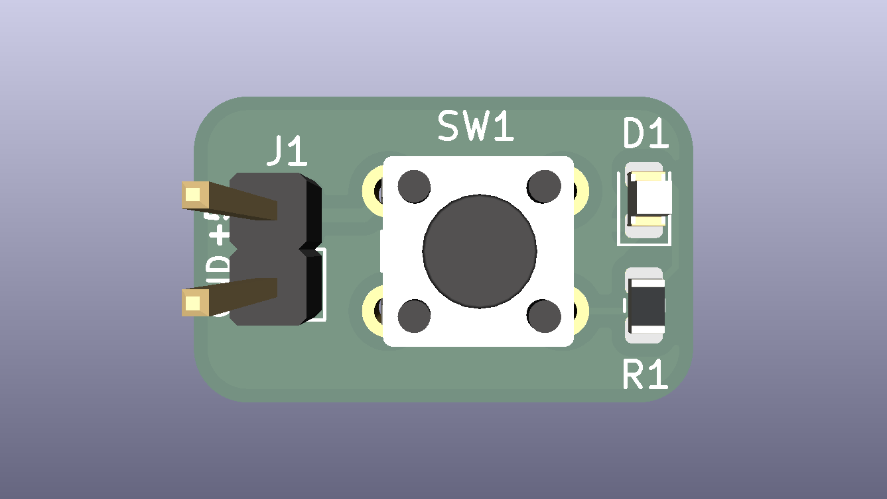
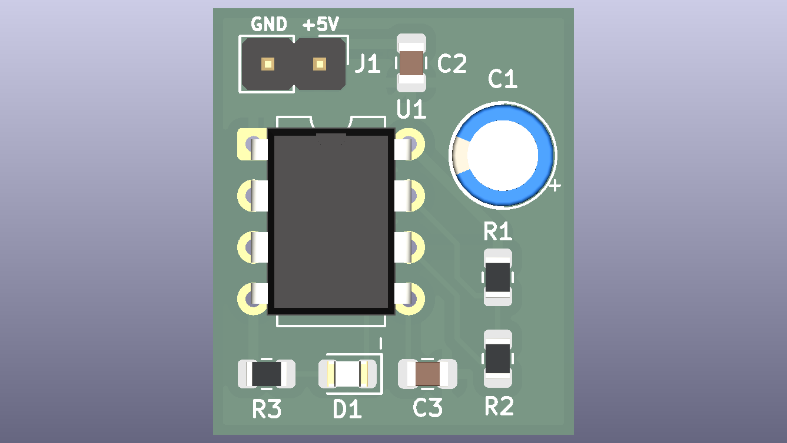

# KiCad Learning Path


> My hands-on journey from complete beginner to advanced electronics and PCB design with KiCad, built from small, simple circuits.
> Every project teaches one new idea and is documented with schematics, calculations, timing diagrams, layout rules, verification reports and manufacturing files.

## Table of contents

- [About this repository](#about-this-repository)
- [Learning approach](#learning-approach)
- [Projects so far](#projects-so-far)
- [Roadmap](#roadmap)
- [Coverage by track](#coverage-by-track)
- [Components index](#components-index)
- [What every project includes](#what-every-project-includes)
- [Repository structure](#repository-structure)
- [Tools](#tools)
- [How to open a project](#how-to-open-a-project)
- [Feedback](#feedback)
- [License](#license)

## About this repository

This repository documents my path through electronics and PCB design. I build one small circuit at a time, calculate it by hand, design it in KiCad, check it with ERC and DRC, prepare the manufacturing files, and write down what I learned.

The projects are ordered so that each one builds on the last. If you are learning too, start at Project 1 and work forward. The complete plan, with the components and ideas of every project, is in [ROADMAP.md](ROADMAP.md).

## Learning approach

| Rule | Why |
|---|---|
| One new idea per board | So you can see exactly what each component does |
| About 12 parts or fewer | Small enough to understand every connection |
| Through-hole parts and 0805 SMD only | Hand-solderable, no special equipment |
| 2-layer board, standard KiCad libraries | Cheap to build and easy to reproduce |
| Calculate first, then build, then measure | Theory is checked against reality |
| Timing or waveform diagram wherever signals change over time | Turns formulas into something you can verify on an oscilloscope |

## Projects so far

| # | Project | Preview | What it teaches | Documentation |
|---|---|---|---|---|
| 1 | [LED + Push-Button](01-led-button/) |  | Ohm's law, LED current limiting, resistors and switches, the full KiCad workflow, Gerber export | [README](01-led-button/README.md) · [Design notes](01-led-button/docs/DESIGN_NOTES.md) |
| 2 | [555 LED Blinker](02-555-blinker/) |  | Capacitors, RC time constant, the 555 timer, decoupling, ground pours and vias, timing diagram | [README](02-555-blinker/README.md) · [Design notes](02-555-blinker/docs/DESIGN_NOTES.md) |

## Roadmap

Fifteen simple circuits, from the first resistor to a complete microcontroller board.

| # | Project | Level | Track | Key ideas | Status |
|---|---|---|---|---|---|
| 1 | [LED + Push-Button](01-led-button/) | Beginner | Basics | Resistor, LED, switch, Ohm's law | Done |
| 2 | [555 LED Blinker](02-555-blinker/) | Beginner | Timing | Capacitor, timer IC, RC timing, decoupling | In progress |
| 3 | Voltage Divider, Potentiometer and Light Sensor | Beginner | Analog | Divider formula, loading effect, LDR, test points | Planned |
| 4 | NPN Transistor Switch | Beginner | Analog and power | BJT, base resistor, flyback diode, saturation | Planned |
| 5 | Diode Power Entry and 5 V Linear Regulator | Beginner | Power | Reverse-polarity protection, regulator, heat dissipation | Planned |
| 6 | RC Low-Pass Filter | Intermediate | Analog | Cutoff frequency, step response, frequency response | Planned |
| 7 | Op-Amp Buffer and Amplifier | Intermediate | Analog | Feedback, gain, single-supply operation | Planned |
| 8 | Comparator Night-Light | Intermediate | Analog to digital | Comparator, hysteresis, sensor to switch | Planned |
| 9 | Logic Gates Trainer | Intermediate | Digital | 74HC gates, truth tables, logic levels, pull-downs | Planned |
| 10 | Switch Debouncer and D Flip-Flop | Intermediate | Digital | Contact bounce, SR latch, clocked memory | Planned |
| 11 | LED Chaser (555 + Decade Counter) | Advanced | Digital | Counters, clocking, sequential logic | Planned |
| 12 | MOSFET Load Switch and PWM Dimmer | Advanced | Power and analog | N-MOSFET, gate drive, PWM duty cycle | Planned |
| 13 | Buck Converter | Advanced | Power | Inductor, switching regulator, efficiency, loop layout | Planned |
| 14 | Digital Counter with 7-Segment Display | Advanced | Digital | Counter and decoder IC, display driving | Planned |
| 15 | Microcontroller Starter Board (ATtiny) | Advanced | Digital, analog and power | MCU, programming header, reset, ADC input | Planned |

**Status:** Done = built, verified and documented. In progress = designed or being documented. Planned = not started. The plan may be adjusted as I learn.

## Coverage by track

| Track | Projects |
|---|---|
| Analog | 3, 4, 6, 7, 8, 12, 15 |
| Digital | 2, 9, 10, 11, 14, 15 |
| Power | 4, 5, 12, 13, 15 |

## Components index

| Component | First used in |
|---|---|
| Resistor, LED, push-button | Project 1 |
| Capacitor (ceramic and electrolytic), 555 timer | Project 2 |
| Potentiometer, light-dependent resistor | Project 3 |
| NPN transistor | Project 4 |
| Diode, linear voltage regulator | Project 5 |
| Op-amp | Project 7 |
| Comparator | Project 8 |
| Logic gates | Project 9 |
| Flip-flop | Project 10 |
| Counter | Project 11 |
| MOSFET | Project 12 |
| Inductor, switching regulator | Project 13 |
| Decoder and 7-segment display | Project 14 |
| Microcontroller | Project 15 |

## What every project includes

- **README**: overview, specifications, images, bill of materials, netlist, testing and status
- **Design notes**: electronics theory, step-by-step calculations with worst-case analysis, KiCad configuration, layout rules and the reasons for them
- **Timing or waveform diagram** wherever signals change over time
- **Verification**: saved ERC and DRC reports and a Gerber viewer check
- **Manufacturing files**: Gerbers, drill files and BOM, ready for a low-cost fab
- **Test procedure**: expected measurements to compare against the real board

## Repository structure

```
kicad-learning-path/
├── README.md                    this index
├── ROADMAP.md                   the full 15-project plan
├── LICENSE
├── .gitignore
├── 01-led-button/
│   ├── README.md
│   ├── 01_led_button.kicad_pro / .kicad_sch / .kicad_pcb
│   ├── fabrication/             Gerbers, drill files, BOM
│   └── docs/                    design notes, schematic PDF, images, reports
├── 02-555-blinker/
│   ├── README.md
│   ├── 02_555_blinker.kicad_pro / .kicad_sch / .kicad_pcb
│   ├── fabrication/             Gerbers, drill files, BOM
│   └── docs/                    design notes, schematic PDF, timing diagram, images, reports
└── 03-... to 15-...             added as each project is completed
```

**Naming:** project folders are `NN-short-name/` and the KiCad files inside are `NN_short_name.*`.

**Every project folder follows the same layout:**

```
NN-short-name/
├── README.md
├── NN_short_name.kicad_pro / .kicad_sch / .kicad_pcb
├── fabrication/
│   ├── gerbers/
│   ├── NN_short_name_gerbers.zip
│   └── bom.csv
└── docs/
    ├── DESIGN_NOTES.md
    ├── schematic.pdf
    ├── images/
    └── reports/
```

## Tools

| Tool | Version |
|---|---|
| KiCad | 10.x |
| Libraries | Standard KiCad libraries only |
| Target fab | Low-cost 2-layer service (for example JLCPCB) |
| Gerber check | KiCad Gerber Viewer or any third-party viewer |
| Version control | Git and GitHub |

## How to open a project

1. Install [KiCad](https://www.kicad.org/download/).
2. Clone or download this repository.
3. Open the `.kicad_pro` file inside any project folder.

## Feedback

Spotted a mistake in a calculation, or have a suggestion for a better layout or a simpler explanation? Please open an issue. Corrections are welcome.

## License

Released under the [MIT License](LICENSE).

Author: **Nitish Ghadage** · [GitHub](https://github.com/nitu2126)
